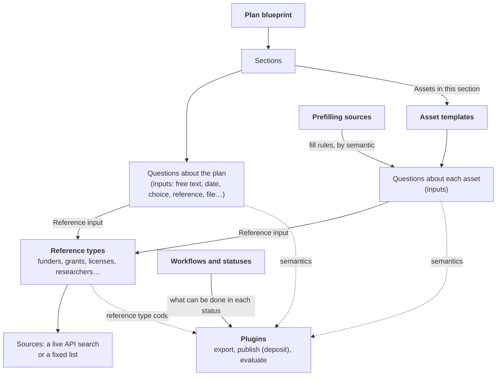

# How it fits together

Before you configure anything, learn how the pieces depend on each other: what a plan is built from, where the answers to look-up questions come from, how plugins find the answers they need, and what a new organisation already has before you touch it. The [Getting started](/docs/administering/getting-started.md) checklist then takes you through the setup in order.

## The building blocks

- **Plan blueprints** define a plan: its sections, the questions about the plan as a whole (title, funding, contacts, and your own), and, in the sections that collect assets, which asset templates authors can use. See [Plan Blueprints](/docs/administering/content-management/blueprints/index.md).
- **Asset templates** define the questions about one output of the plan, such as a dataset, software, or a sample collection. Blueprints and templates are built in the same editor, from questions that hold one or more inputs. See [Asset Templates](/docs/administering/content-management/templates/index.md).
- **Types** group blueprints and templates, for example *Dataset* or *Software*. See [Types](/docs/administering/content-management/types.md).
- **Reference types** are the look-up lists behind **Reference** inputs: grants from OpenAIRE, organizations from ROR, researchers from ORCID, licenses from a fixed list. Each has a **Code** that plugins recognize. See [Reference Types](/docs/administering/system-configuration/reference-types.md).
- **Prefilling sources** let authors start an asset from a record in another system; their fill rules put the record's values into the template questions that carry a given semantic. See [Prefilling Sources](/docs/administering/system-configuration/prefilling-sources.md).

Only finalized templates can be offered in a blueprint, and only finalized blueprints can be used for new plans, so build templates before blueprints.

## Semantics and plugins

Plugins never see your question titles. They find the answers they need through **semantics**: keys such as `zenodo.subject` or `rda.dataset.distribution.host.url` that you put on questions, inputs, sections, and answer options. One key can serve several plugins at once. See [Semantics](/docs/administering/content-management/templates/semantics.md).

- **Export formats** (file transformers) turn a plan into a document or a machine-readable file, such as DOCX, PDF, or RDA maDMP JSON. See [File transformers](/docs/optional-services/file-transformers/index.md).
- **Repositories** (deposit services) publish a plan and return a DOI. Besides semantics, they recognize licenses, funders, grants, organisations, and researchers by the code of their reference type. See [Set up publishing to a repository](/docs/administering/publishing-setup.md).
- **Evaluators** check a plan against quality or FAIR criteria. See [Evaluator services](/docs/optional-services/evaluator-services.md).
- **Prefilling sources** use semantics in the opposite direction, to fill questions in.

The installation decides which plugins exist; each organisation decides which of them its users get, and with which settings, under **Settings > Plugins**.

## Workflows and statuses

A **workflow** lists the statuses plans (or assets) move through, the status new work starts in, and the moves allowed between statuses. Each **status** decides what it counts as (**Draft**, **Finalised**, **Cancelled** for assets, or **A step in between**), who may move work into it, and what people can do in it: **Publish**, **Download**, and **Evaluate** for plans. So a plan can be published only from a status that allows **Publish**. See [Plan & asset workflows](/docs/administering/system-configuration/workflows.md).

## Organisations

An installation hosts one or more **organisations**, each with its own users, plans, and settings. One of them, the **Default organisation**, is special: what it owns is shared with every other organisation, and its settings are the fallback for organisations that have not set their own (see [below](#the-default-organisation-and-inheritance)). Users work in one organisation at a time and switch with the organisation button in the top bar. See [Organisations](/docs/administering/tenant-management/tenants.md).

## Roles

Three kinds of role decide what a person can do. **Installation roles** apply everywhere; **organisation roles** apply in one organisation, and a person can hold different ones in different organisations; **plan roles** apply to one plan and are given by its owners when they [invite collaborators](/docs/using/plans/invite-collaborators.md#plan-roles). The codes are the identifiers used in Keycloak and in `permissions.yml`.

| Kind | Role | Code | What it can do |
|---|---|---|---|
| Installation | **System Administrator** | `Admin` | Everything, in every organisation it belongs to, plus the **Installation** pages: **Organisations**, **Data Transfer**, **Maintenance**, **Edit Locks**, and **Notification Log**. Becomes Organisation Admin of every new organisation. |
| Installation | **Installation Manager** | `InstallationAdmin` | Creates, edits, and deletes organisations (**Organisations**), manages every account of the installation and its roles (**Users**, which lists all accounts), except the System Administrator role, and opens **Answers**. Cannot invite users. Becomes a Member of every new organisation. |
| Installation | **Signed-in User** | `User` | Can sign in. Organisation roles decide the rest. |
| Organisation | **Organisation Admin** | `TenantAdmin` | Everything in the organisation: all **Templates** and **Data Sources** pages, **Research Insights**, **Users** (including **Invite users**), and every section of **Settings**. Can open, edit, finalize, publish, and delete every plan of the organisation, as its Owner could. |
| Organisation | **Template Manager** | `TenantPlanManager` | **Plan Blueprints**, **Asset Templates**, and **Types**, but not the **Data Sources** pages. Needs **Member** as well to see **My Plans** and **My Assets**. |
| Organisation | **Content & Workflow Manager** | `TenantConfigManager` | These sections of **Settings**, and no others: **Languages & texts**, **Plan & asset workflows**, **Help pages & legal**, and **Notification templates**. Needs **Member** as well to see **My Plans** and **My Assets**. |
| Organisation | **Member** | `TenantUser` | Creates plans and assets and works on the plans shared with them. No administration pages. |
| Plan | **Owner** | `Owner` | Everything on the plan: edit it, manage collaborators, change its status, download, publish, evaluate, copy it, create new versions, and delete it. |
| Plan | **Editor** | `DescriptionContributor` | Edits, finalizes, copies, and deletes assets; views and downloads the plan, and comments. |
| Plan | **Data Steward** | `DataSteward` | As an Editor. |
| Plan | **Data Privacy Officer (DPO)** | `DataPrivacyOfficer` | As an Editor. |
| Plan | **Reviewer** | `Reviewer` | Views and downloads the plan, and comments. |
| Plan | **Ethics Reviewer** | `EthicsReviewer` | As a Reviewer. |
| Plan | **Viewer** | `Viewer` | Views and downloads the plan. |

A plan role given for some sections of a plan applies to those sections only. Which statuses a plan role may move a plan or asset into is set per status in the [workflow](/docs/administering/system-configuration/workflows.md#authorization-and-transitions). Organisation Admin includes everything Template Manager and Content & Workflow Manager can do. Every account also holds **Signed-in User**.

Organisation roles are given in **Organisation > Users** (see [Users](/docs/administering/user-management/tenant-users.md)) or through Keycloak groups (see [Keycloak](/docs/deployment/configuration/keycloak.md)). How the first Organisation Admin of a new organisation is appointed is described in [Getting started](/docs/administering/getting-started.md#2-appoint-the-first-organisation-admin).

## The Default organisation and inheritance {#the-default-organisation-and-inheritance}

A new organisation is not empty. It reaches the Default organisation in three ways:

- **Shared records**: records the Default organisation owns are visible to every organisation and can be used there, but edited only in the Default organisation. Admin listings mark them **Shared** and offer a **Shared by default organisation** tab (see [Admin listings](/docs/administering/admin-listings.md)). To change one for your organisation only, copy it.
- **Fallback**: a setting your organisation has not saved is taken from the Default organisation, and, when that has none either, from the installation's built-in default. Unless the table below says otherwise, the fallback takes the Default organisation's setting as a whole: once your organisation saves its own, none of the Default organisation's values for that setting apply any more, even those you left empty.
- **No fallback**: the setting applies only if your organisation sets it.

The Default organisation itself sees only its own records, never those of other organisations.

| What | How it reaches other organisations |
|---|---|
| Plan blueprints and asset templates | Shared |
| Blueprint types and asset template types | Shared, under **Shared from the installation** on the [Types](/docs/administering/content-management/types.md) page |
| Reference types and their entries | Shared |
| Prefilling sources | Shared |
| Plan and asset statuses | Shared |
| Comment statuses | Shared |
| Webhooks | Shared as records: other organisations see the Default organisation's webhooks, but each webhook receives only the events of its own organisation. See [Webhooks](/docs/administering/webhooks.md). |
| Plan and asset workflows | Fallback: without a workflow of its own, the organisation uses the Default organisation's |
| Languages & texts | Fallback, merged text by text: your organisation's changes apply on top of the Default organisation's, which apply on top of the built-in texts. The languages offered are those of both organisations. See [Languages](/docs/administering/system-configuration/languages.md#how-texts-are-stored). |
| Help pages & legal | Fallback, page by page and language by language: your page, else the Default organisation's, else the built-in text (**Customised**, **Shared**, **Built-in**). See [Help pages & legal](/docs/administering/system-configuration/supportive-material.md). |
| Notification templates | Fallback, per notification, channel, and language: your text, else the Default organisation's, else the built-in text. See [Notification templates](/docs/administering/system-configuration/notification-templates.md). |
| Branding (main color, logo, custom style variables) | Fallback |
| Language & region (defaults of new users) | Fallback |
| Content defaults (blueprint for new plans, featured blueprints and templates, references shown in lists) | Fallback |
| Guided tours | Fallback; when neither organisation has saved the setting, tours are on |
| Plugin settings | Fallback, for all plugins together: once your organisation saves the settings of any plugin, none of the Default organisation's plugin settings apply. An empty setting takes the plugin's own default. A blueprint or asset template can override them, setting by setting, in its **Export template** card. |
| Which plugins are offered, and plugins added with **Add plugin** | No fallback: each organisation starts from the plugins the installation registers |
| Terms and conditions | No fallback: without terms of its own, the organisation's users are not asked to accept any |
| Plans and assets | Never shared: they belong to the organisation they were created in. Only public plans and assets are listed for everyone, under **Public Plans** and **Public Assets**. |

:::note
The settings pages show the value that applies. A setting your organisation takes from the Default organisation is marked **Set by the installation** and is read-only until you click **Use your own value**, which starts your organisation's own copy. **Reset to default** removes your organisation's own value, so the Default organisation's value, or the built-in one, applies again. See [How settings are saved](/docs/administering/tenant-management/tenant-configuration.md#how-settings-are-saved).
:::
