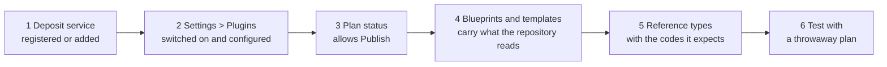

# Set up publishing to a repository

Users [publish a plan](/docs/using/plans/deposit-a-plan.md) by depositing it in a research repository such as Zenodo, which returns a persistent identifier, usually a DOI. Publishing works only when five things are in place: a deposit service the organisation can use, its settings, a plan status that allows publishing, blueprints whose questions the repository can read, and the reference types those questions draw on. The steps below cover them in order, with Zenodo as the example; the other repositories differ only in their settings and in what they read from a plan.

## 1. Make the deposit service available

A deposit service is a plugin that runs beside OpenCDMP and talks to one kind of repository. There are two ways to connect one:

- **For every organisation**: the installation registers the service in the backend configuration. See [Plugin registration](/docs/deployment/configuration/plugin-services.md) and, for the service's own settings (repository address, installation account), [Deposit Services configuration](/docs/deployment/configuration/backend/deposit.md). A service registered this way is listed in every organisation as **Provided by the installation**.
- **For one organisation**: an Organisation Admin connects a service that runs elsewhere with **Add plugin** under **Settings > Plugins**, using the address and sign-in details its provider gives. See [Add a plugin](/docs/administering/tenant-management/plugins.md#add-a-plugin).

Either way, the repository also needs two export formats: one that produces the PDF copy of the plan (usually the DOCX transformer) and one that produces the machine-readable RDA JSON copy. They are named in the registration (`pdfTransformerId`, `rdaTransformerId`) or, for a plugin you add, in **Transformer for the PDF copy** and **Transformer for the machine-readable copy**.

The supported repositories and their versions are listed in [Deposit Services](/docs/optional-services/deposit-services/index.md).

## 2. Switch it on and configure it

Go to **Organisation > Settings > Plugins**. The repository is listed under **Repositories** with its status; it must read *Connected*.

1. Turn on its switch to offer it to your users, and save. See [Offer or hide a plugin](/docs/administering/tenant-management/plugins.md#offer-or-hide-a-plugin).
2. Click **Configure** and open the **Settings** tab. The groups that matter most:
   - **Who publishes**: whether users publish under the organisation's account, their own account, or either (**Ways to publish**, **Preselected**).
   - **Organisation account**: the credentials of the organisation's own account in the repository, for example a Zenodo **Access token**. Left empty, the installation's account is used.
   - **Files**: **Files to deposit**, which of the plan document, the RDA JSON file, and the supporting files are uploaded.
   - **Zenodo record** (the name follows the repository): defaults for every record, such as the **Community**, **Publisher**, **Resource type**, and **Default licence**.
   - **Reference types**: only when your reference types use codes other than the ones in [step 5](#5-reference-types-the-repository-reads).
3. Click **Save changes**.

Every setting is described in [Repositories](/docs/administering/tenant-management/plugins.md#repositories), and the full list per repository in [Deposit Services: organisation settings](/docs/optional-services/deposit-services/index.md#organisation-settings). An organisation that has never saved plugin settings follows those of the Default organisation; see [What falls back to the Default organisation](/docs/administering/how-it-fits-together.md#the-default-organisation-and-inheritance).

## 3. Allow publishing in a plan status

**Publish** appears on a plan only while its status allows it. Under **Settings > Plan & asset workflows**, on the **Plans** tab, click the status in which plans may be published and tick **Publish** under **In this status people can**. Usually this is a status that counts as **Finalised**, because the record should not change after it has a DOI. See [The status panel](/docs/administering/system-configuration/workflows.md#status-drawer).

In the statuses shipped with a new installation, `Finalized` already allows **Publish**. Whatever the status, only the plan's **Owner**, an Organisation Admin, or a System Administrator can publish (see [Roles](/docs/administering/how-it-fits-together.md#roles)).

## 4. Give blueprints and templates what the repository reads

A repository record is built from the plan. Some values need nothing from you; the rest are found through [semantics](/docs/administering/content-management/templates/semantics.md), keys you put on the questions of blueprints and asset templates, and through the plan's references (step 5).

For Zenodo:

- **Filled in without semantics**: the title, description, and version of the plan; the publisher and resource type from the settings; the access level from the plan's access setting; the creators from the plan's members, as the **Authors from plan members** setting decides (every member, owners and editors, owners only, or none); and, for a public plan with **Link the public plan page** on, a link back to the plan's public page.
- **Worth adding**, as semantics on blueprint or asset template questions:

  | Semantic | Fills in |
  |---|---|
  | `zenodo.subject` | Keywords (subjects) |
  | `zenodo.language` | Language, as an ISO 639-3 code; otherwise the **Default language** setting |
  | `zenodo.community` | The community; otherwise the **Community** setting |
  | `zenodo.publication_date` | The publication date; otherwise the day of publishing |
  | `zenodo.related_identifiers.<relation>` | Links to related datasets, publications, and other outputs |

A blueprint therefore needs no semantics for a first, valid deposit. Every key Zenodo reads is listed in the [Zenodo semantics reference](/docs/optional-services/deposit-services/zenodo-semantics.md); the other repositories have their own pages under [Plugin semantics reference](/docs/optional-services/deposit-services/index.md#plugin-semantics-reference). DSpace and Fedora read everything, references included, through semantics.

## 5. Reference types the repository reads {#5-reference-types-the-repository-reads}

Licenses, funders, grants, organisations, and researchers reach the record from the plan's **references**: answers to blueprint questions of the **Reference** input type. The repository recognizes each kind by the **Code** of its reference type:

| Kind of reference | Expected code | Read by | What it becomes in Zenodo |
|---|---|---|---|
| Licenses | `licenses` | Zenodo, CKAN, Dataverse | The record's license; without one, the **Default licence** setting |
| Funders | `funders` | Zenodo, Dataverse | Funding |
| Grants | `grants` | Zenodo, Dataverse | Funding, under the first funder |
| Organisations | `organisations` | Zenodo, CKAN, Dataverse | The creators' affiliation |
| Researchers | `researchers` | Zenodo, Dataverse | Contributors, with their ORCID iD when the reference came from ORCID |

So that a plan has these references, the blueprint needs a **Reference** question for each kind, set to the matching reference type. If your reference types use other codes, enter them in the repository's **Reference types** settings group; the installation can also change the defaults through the service's environment variables.

Two semantics sit on the reference types themselves, not on questions: `zenodo.metadata.rights.link` on the license's address field, and `zenodo.metadata.contributors.person_or_org.given_name` and `…family_name` on the researcher's name fields. The seeded **Licenses** and **Researchers** types already carry them.

### Reference types shipped with OpenCDMP

A new installation starts with these reference types in the Default organisation, shared with every organisation:

| Name | Code |
|---|---|
| CESSDA Data Catalogue | `cessda-dc` |
| CESSDA Vocabulary Service | `cessda-vs` |
| CESSDA ELSST | `cessda-elsst` |
| Currencies | `currencies` |
| Datasets | `datasets` |
| FAIRsharing Policies | `fair-sharing-policies` |
| FAIRsharing Standard | `fair-sharing-standard` |
| Field of Science | `fos` |
| Funders | `funders` |
| Grants | `grants` |
| Journals | `journals` |
| Licenses | `licenses` |
| Metadata Services | `Metadata Services` |
| Organisations | `organisations` |
| Projects | `projects` |
| Publication Repositories | `pubRepositories` |
| Publications | `publications` |
| Registries | `registries` |
| Repositories | `repositories` |
| Researchers | `researchers` |
| Select format(s) | `Select format(s)` |
| Services | `services` |
| Taxonomies | `taxonomies` |

An installation upgraded from an earlier version, or one whose administrators changed these types, may hold a different set. The **Reference Types** page under **Data Sources** always shows the current names and codes; see [Reference Types](/docs/administering/system-configuration/reference-types.md).

## 6. Test with a throwaway plan

Before your users publish, run one plan through the whole path:

1. Create a plan from the blueprint your users will use, and answer the questions the repository reads, including a license, a funder, and a researcher.
2. Move it to the status that allows **Publish**. For a status that counts as **Finalised**, the plan must be valid first.
3. Click **Publish**, choose the repository, and pick the account. Check that **Publish as** offers the accounts you allowed.
4. In the review (shown by repositories marked **Preview before deposit**), check the metadata and the files. Stop here with **Cancel** if you only want to check the mapping.
5. To go all the way, publish to a test repository, not the real one: a published record and its DOI cannot be withdrawn from OpenCDMP. Zenodo, for example, offers `sandbox.zenodo.org`, which the installation selects with the service's `DEPOSIT_ZENODO_URL`.

If publishing fails, the dialog shows the repository's message; see [If publishing fails](/docs/using/plans/deposit-a-plan.md#if-publishing-fails) and [Troubleshooting](/docs/administering/troubleshooting.md#publishing-fails-for-users). The [Notification Log](/docs/administering/notification-log.md) shows whether the plan's members were told about the deposit.

## See also

- [Publish a plan](/docs/using/plans/deposit-a-plan.md): what users see
- [Deposit Services](/docs/optional-services/deposit-services/index.md): the supported repositories and their settings
- [Deposit plugin development](/docs/developers/plugins/deposit.md): writing a service for another repository
