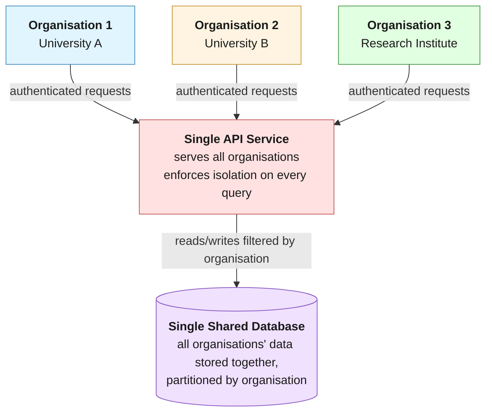

# Organisations

:::info

An **organisation** is an isolated workspace, for example an institution, that uses the installation independently without the need of a separate deployment. Each organisation keeps its own users, data, and settings apart from the others. There is also a *default* organisation, which is not editable.

:::

The **Organisations** page lists all organisations of the installation. The columns are:

- **Name**: the display name, with the organisation's code below
- **Created** (hidden by default) and **Updated**
- **Members**: the number of people in the organisation
- **Plans**: the number of plans in the organisation

Use the **Display settings** button at the top right to choose which columns are visible.

This listing supports the standard [admin listing](/docs/administering/admin-listings.md) controls: search, Show deleted items, column picker, and density. It has no scope tabs and no filters beyond those shared controls.

## Creating and editing an organisation

Click **Create Organisation** at the top of the page to open the **New organisation** drawer. To edit an organisation, click its row, or select **Edit details** from the three dots menu at the end of the row; the **Edit organisation** drawer opens. The drawer has three fields, all required:

- **Name**: The display name of the organisation. This name appears in the user interface.
- **Code**: The identifier of the organisation. It is used in addresses, like `/t/your_code`, and can contain lowercase letters, numbers, and underscores only. The code cannot be changed after the organisation is created.
- **Description**: A short description of the organisation.

Click **Save** to save the organisation and close the drawer.

A new organisation is configured in its own [Settings](/docs/administering/tenant-management/tenant-configuration.md).

## The first Organisation Admin {#first-organisation-admin}

When an organisation is created, every System Administrator of the installation becomes its **Organisation Admin**, and every Installation Manager becomes a **Member**. Installations that manage roles in Keycloak get the same roles there. If none of them can be added, the organisation is not created. The new organisation appears in their organisation menu after they reload the page or sign in again.

To give the organisation its own administrator, select it in the organisation menu, then either:

- as a System Administrator, open **Organisation > Users**, click **Invite users**, and invite the person with the **Organisation Admin** role (the invitation is for the organisation you are working in); or
- as a System Administrator or Installation Manager, open **Users** in the **All organisations** view (an Installation Manager's **Users** page always shows all accounts), click an account that has signed in at least once, tick **Organisation Admin** in the group of the organisation you are working in, and click **Save roles**, then **Change roles**.

Installations that manage roles in Keycloak can instead add the person to the `tenant-<code>` subgroup of the Organisation Admin group; see [Keycloak](/docs/deployment/configuration/keycloak.md).

## Row actions

The three dots menu at the end of a row offers:

- For organisations your account belongs to, shortcuts that switch to that organisation and open one of its pages: **Open its settings** (Settings), **Members** (Users), and **Export or copy content** ([Data Transfer](/docs/administering/tenant-management/tenant-transfer.md))
<!-- kpi disabled -->
<!-- - **Usage**, when the KPI service is enabled, which switches to the organisation and opens its usage dashboard -->
- **Edit details**, which opens the edit drawer
- **Delete**, which deletes the organisation after a confirmation

:::tip
To move the content of an organisation to another installation, seed a new organisation with the content of an existing one, or permanently clear the content of an organisation, use the [Data Transfer](/docs/administering/tenant-management/tenant-transfer.md) page.
:::

## Authorization

Users with the **System Administrator** or **Installation Manager** role can access this page, and create, edit, and delete organisations. See [Roles](/docs/administering/how-it-fits-together.md#roles).

## Navigation

In the side navigation menu, switch to the **Admin** view and go to **Installation > Organisations**.

---

## Multitenancy

There is always one organisation available on the platform, called `Default`. It is the organisation assigned by default to all the entities (users, assets, etc.), unless a different organisation is selected.

:::info
Configuration entities defined in the `Default` organisation (for example blueprints, asset templates, plan and asset statuses, reference types, and prefilling sources) are shared with every organisation. On the [admin listing](/docs/administering/admin-listings.md) pages for these entities, the **Owned by [organisation name]** / **Shared by default organisation** / **All** scope tabs let an administrator with an organisation selected show only the current organisation's own records, only the shared default-organisation records, or both.
:::

To change the organisation you are working in, click the organisation button in the top bar (it shows the name of the current organisation) and select another organisation from the list.

:::tip

The organisation button is only available when the logged-in user belongs to one or more organisations. Otherwise, the user is attached only to the default organisation. Users with the **System Administrator** role can select from all the available organisations.

:::

