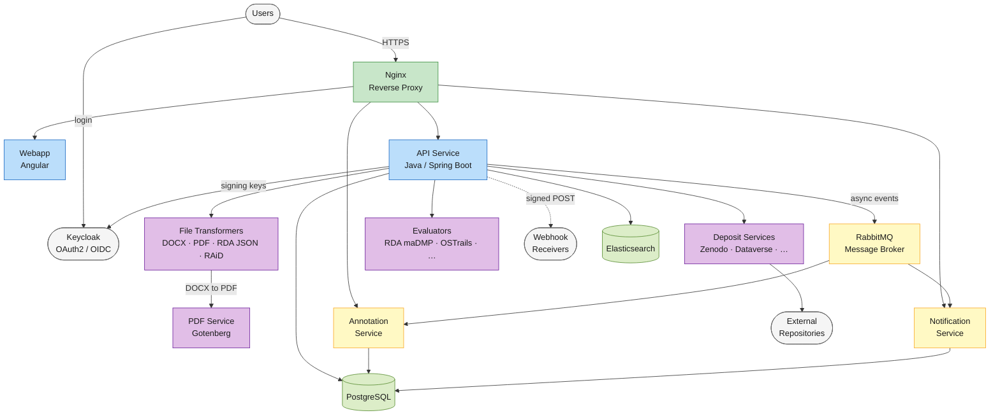

# System architecture

OpenCDMP is built on a **microservices architecture**. Each capability runs as an independent Docker container, and the containers communicate through APIs and an asynchronous message bus, so each service can be developed, deployed, and scaled independently.

<!-- kpi disabled so kpi service is not added here -->

---

## Services

### Nginx — reverse proxy

The sole service exposed to the internet. Handles SSL/TLS termination, routes incoming requests to the Webapp, the API, the annotation and notification services (`/api/annotation/`, `/api/notification/`), and, in the Docker example, Keycloak (`/auth/`), and hides all internal services from direct external access. See [what the example proxy routes](/docs/deployment/install/production.md#proxy-routes).

### Webapp — Angular frontend

Serves the browser-based user interface. It calls the API service, and the annotation and notification services for comments and notifications, all through the reverse proxy, and signs users in through Keycloak.

### API service — Java backend

The core of the platform. Handles all business logic, exposes the REST API consumed by the Webapp, orchestrates plugin calls (file transformers, deposit services, evaluators), writes to PostgreSQL, indexes to Elasticsearch, and publishes events to RabbitMQ. When [webhooks](/docs/administering/webhooks.md) are enabled, it also delivers signed HTTP callbacks to external receivers.

### Annotation service

Manages the lifecycle of annotations (comments and reviews): creating, resolving, and tracking annotation threads on plans and assets. *Closed source, free-to-use license.*

### Notification service

Sends email and in-app notifications triggered by platform events (invitations, status changes, annotations, etc.). Templates and preferences are configurable. *Closed source, free-to-use license.*

### RabbitMQ — message broker

Decouples the API Service from the Annotation and Notification services. The API publishes domain events; downstream services subscribe and react asynchronously.

### PostgreSQL — primary database

Stores all persistent application data: plans, assets, blueprints, templates, users, configuration, comments, and notifications. The API service, the annotation service, and the notification service share one database, and in the Docker example Keycloak keeps its own database on the same server.

### Elasticsearch — search index

Powers full-text search across plans and assets. The API keeps the index in sync on every create, update, and delete operation.

### File transformers — pluggable export and import

Independent Spring Boot microservices, one per format. Each transformer implements a standard interface. The API service calls the transformers registered in its configuration (`file-transformer.sources`) or added by an organisation, and asks each one for its formats; transformers do not register themselves. PDF export is handled by the DOCX transformer, which converts its Word output to PDF through the PDF service. See [File Transformer Plugin](/docs/developers/plugins/file-transformers.md) and [Registering plugin services](/docs/deployment/configuration/plugin-services.md).

### Deposit services — pluggable DOI assignment

Independent Spring Boot microservices, one per repository. Each service authenticates with its target repository, uploads the plan files, and returns the minted DOI. Like the transformers, they are registered in the API service configuration (`deposit.sources`) or added by an organisation. See [Deposit Plugin](/docs/developers/plugins/deposit.md).

### Evaluators — pluggable assessment

Independent Spring Boot microservices that assess a plan, or each of its assets, against a standard such as RDA maDMP, OSTrails, or FAIR, and return ranked results. They are registered in the API service configuration (`evaluator.sources`) or added by an organisation. See [Evaluator Plugin](/docs/developers/plugins/evaluator.md).

<!-- kpi disabled  -->
<!-- ### KPI Service — Analytics (optional)

Stores indicator points that the API publishes for plans, assets, references, users, blueprints, and templates, and renders them as the dashboards shown on the Statistics page. The API publishes the indicator and dashboard definitions automatically at startup when the integration is enabled. See [KPI Service](optional-services/kpi.md). -->

### PDF service — Gotenberg

A [Gotenberg](https://gotenberg.dev/) container (`opencdmp.pdf-service` in the Docker example) that converts documents to PDF. Only the DOCX transformer calls it, at the address in its `PDF_CONVERTER_URL`. See [File Transformer Services](/docs/deployment/configuration/backend/file-transformers.md#pdf-conversion).

### Keycloak — authentication

Manages user identities, roles, organisation memberships, and access tokens. The Webapp signs users in through Keycloak; the API Service and the plugins validate tokens with the realm's signing keys, and the API Service manages users' role groups through the Keycloak admin API. See [Keycloak setup](/docs/deployment/configuration/keycloak.md).

---

## See also

- [Installation](/docs/deployment/install/index.md) - Start all of these services with Docker Compose
- [Before going to production](/docs/deployment/install/production.md) - Secure, size, and monitor the services
- [Configuration](/docs/deployment/configuration/index.md) - The settings of each service
- [Registering plugin services](/docs/deployment/configuration/plugin-services.md) - Add file transformers, deposit services, and evaluators
- [Plugins for developers](/docs/developers/plugins/index.md) - Build your own plugin
