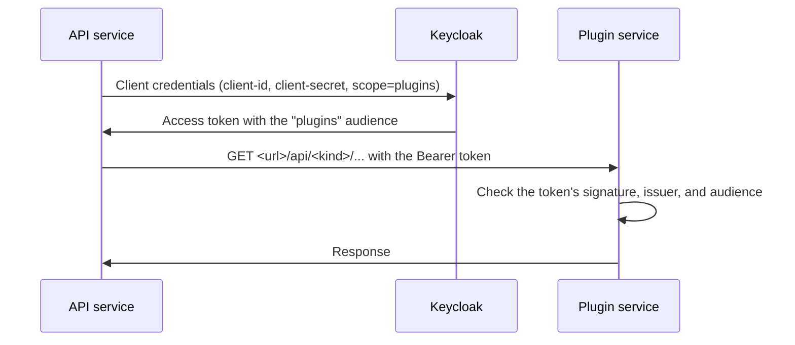

# Registering plugin services

[File transformers](/docs/optional-services/file-transformers/index.md), [deposit services](/docs/optional-services/deposit-services/index.md), and [evaluators](/docs/optional-services/evaluator-services.md) are separate services that the API service calls over HTTP. Plugins do not register themselves. Making one available takes four steps:

1. [Run the service](#step-1-run-the-service) where the API service can reach it.
2. [Let it accept the API service's tokens](#plugin-tokens): the plugin and the API service must trust the same Keycloak realm.
3. [Register it](#step-3-register-the-plugin) for the whole installation in the API service configuration, or for one organisation with **Add plugin**.
4. [Check the connection](#step-4-check-the-connection) with **Test connection**.

The settings that every plugin service shares are listed in [Settings common to all plugin services](#settings-common-to-all-plugin-services); the settings of each plugin are on the [file transformer](/docs/deployment/configuration/backend/file-transformers.md), [deposit service](/docs/deployment/configuration/backend/deposit.md), and [evaluator](/docs/deployment/configuration/backend/evaluators.md) pages.

## How the API service calls a plugin



The API service reuses a token for a short while, and caches the configuration each plugin reports for up to ten minutes: after you change a plugin's own settings, the change can take that long to show, or restart the API service.

| Kind | Base path | Configuration endpoint | Id field in the response |
| --- | --- | --- | --- |
| File transformer | `/api/file-transformer` | `GET /api/file-transformer/formats` | `fileTransformerId` |
| Deposit service | `/api/deposit` | `GET /api/deposit/configuration` | `repositoryId` |
| Evaluator | `/api/evaluator` | `GET /api/evaluator/config` | `evaluatorId` |

The id that you register a plugin under must match the id the plugin reports from its configuration endpoint. The ids of the shipped plugins are:

| Plugin | Id |
| --- | --- |
| DOCX file transformer | `docx-file-transformer` |
| RDA JSON file transformer | `rda-file-transformer` |
| RAiD JSON file transformer | `raid-file-transformer` |
| Zenodo, DSpace, CKAN, Dataverse, and Fedora deposit services | `zenodo`, `dspace`, `ckan`, `dataverse`, `fedora` |
| RDA maDMP, OSTrails, and OpenAIRE FAIR evaluators | `rda-maDMP`, `ostrails`, `openaire-fair` |

---

## Step 1: Run the service

Each plugin is a Spring Boot service published as a Docker image (see the image lists of the [file transformers](/docs/optional-services/file-transformers/index.md), [deposit services](/docs/optional-services/deposit-services/index.md), and [evaluators](/docs/optional-services/evaluator-services.md)). The images listen on port `8080`, read `app-<PROFILE>.env` from `/config`, and write their logs to `/logs`.

The Docker example runs the DOCX and RDA JSON transformers, the RDA maDMP evaluator, and the Zenodo deposit service. To add another one, copy the entry of the Zenodo service in `docker-compose.yml` and `docker-compose.override.yml`. For example, the DSpace deposit service:

```yaml title="docker-compose.override.yml"
services:
  opencdmp.dspace:
    container_name: opencdmp.dspace
    image: ${GITHUB_REGISTRY}/opencdmp/repository-deposit-dspace:${DSPACE_APP_TAG}
    restart: unless-stopped
    depends_on:
      opencdmp.backend:
        condition: service_started
    environment:
      - PROFILE=${PROFILE}
    expose:
      - "8080"
    volumes:
      - ${CONFIG_FILES_PATH}/opencdmp/dspace/config:/config
      - ${LOG_FILES_PATH}/opencdmp/dspace:/logs
    networks:
      - opencdmp-backend-network
    healthcheck:
      test: ["CMD-SHELL", "wget -qO- http://localhost:8080/actuator/health | grep UP || exit 1"]
      interval: 30s
      timeout: 10s
      retries: 3
      start_period: 120s
```

Then:

1. Add `DSPACE_APP_TAG` to `.env`.
2. Create `config-files/opencdmp/dspace/config/app-test.env` (with the `PROFILE` of `.env`) with the [common settings](#settings-common-to-all-plugin-services) and the settings of the plugin:

   ```properties title="config-files/opencdmp/dspace/config/app-test.env"
   IDP_ISSUER_URI=http://opencdmp.localhost:8180/auth/realms/OpenCDMP
   IDP_CLAIMS_ROLES_PATH=plugins.roles
   SECURITY_AUDIENCE=plugins

   DEPOSIT_DSPACE_URL=https://dspace.example.org/server/api/
   DEPOSIT_DSPACE_RECORD_URL=https://dspace.example.org/handle/{doi_id}
   DEPOSIT_DSPACE_COLLECTION_ID=51715dd3-5590-49f2-b227-6a663c849921
   DEPOSIT_DSPACE_USERNAME=opencdmp@example.org
   DEPOSIT_DSPACE_PASSWORD=<dspace-password>
   OPENCDMP_DOMAIN=http://opencdmp.localhost:8180/
   ```

3. Start it with `docker compose up -d opencdmp.dspace`.

A plugin that runs elsewhere, for example on another host or at a provider, needs no Compose entry, as long as the API service can reach its address.

---

## Step 2: Let the plugin accept the API service's tokens {#plugin-tokens}

The plugin accepts a request only when its Bearer token was issued by the installation's realm and carries the `plugins` audience. Two things must line up:

- **In the plugin**: `IDP_ISSUER_URI` is the realm URL exactly as the tokens state it (the `IDP_ISSUER_URI` of the API service), `SECURITY_AUDIENCE` is `plugins`, and `IDP_CLAIMS_ROLES_PATH` is `plugins.roles`. The plugin downloads the realm's signing keys from `IDP_ISSUER_URI`, so it must reach Keycloak at that address.
- **In Keycloak**: the `plugins` client scope has an audience mapper that adds the `plugins` client to the token's audience, and the client that the API service signs in with has `plugins` among its client scopes. In the shipped realm, that client is `api`, with `plugins` as an optional scope that the API service requests with `scope=plugins`. See [Keycloak setup](/docs/deployment/configuration/keycloak.md#step-4-create-client-scopes).

The API service takes the client from the registration (`issuer-url`, `client-id`, `client-secret`, `scope` below). In the Docker example, these point to the `FILE_TRANSFORMER_AUTH_*`, `DEPOSIT_AUTH_*`, and `EVALUATOR_AUTH_*` variables of the [API service configuration](/docs/deployment/configuration/backend/index.md#file-transformer-service-authentication).

---

## Step 3: Register the plugin

### For the whole installation {#plugin-registration}

The API service reads the plugins of the installation from three configuration files. The built-in `file-transformer.yml`, `deposit.yml`, and `evaluator.yml` register none; the Docker example overrides them with `file-transformer-test.yml`, `deposit-test.yml`, and `evaluator-test.yml` in `config-files/opencdmp/backend/config/` (the suffix is the `PROFILE`). Each plugin is an entry of a `sources` list:

```yaml title="config-files/opencdmp/backend/config/file-transformer-test.yml"
file-transformer:
  sources:
    - url: http://opencdmp.file.transformer.docx:8080
      transformerId: docx-file-transformer
      issuer-url: ${FILE_TRANSFORMER_AUTH_TOKEN_ENDPOINT}
      client-id: ${FILE_TRANSFORMER_AUTH_CLIENT_ID}
      client-secret: ${FILE_TRANSFORMER_AUTH_CLIENT_SECRET}
      scope: ${FILE_TRANSFORMER_AUTH_SCOPE}
      maxInMemorySizeInBytes: 6554000
    - url: http://opencdmp.file.transformer.rdajson:8080
      transformerId: rda-file-transformer
      issuer-url: ${FILE_TRANSFORMER_AUTH_TOKEN_ENDPOINT}
      client-id: ${FILE_TRANSFORMER_AUTH_CLIENT_ID}
      client-secret: ${FILE_TRANSFORMER_AUTH_CLIENT_SECRET}
      scope: ${FILE_TRANSFORMER_AUTH_SCOPE}
      maxInMemorySizeInBytes: 6554000
```

```yaml title="config-files/opencdmp/backend/config/deposit-test.yml"
deposit:
  sources:
    - url: http://opencdmp.zenodo:8080
      repositoryId: zenodo
      pdfTransformerId: docx-file-transformer
      rdaTransformerId: rda-file-transformer
      issuer-url: ${DEPOSIT_AUTH_TOKEN_ENDPOINT}
      client-id: ${DEPOSIT_AUTH_CLIENT_ID}
      client-secret: ${DEPOSIT_AUTH_CLIENT_SECRET}
      scope: ${DEPOSIT_AUTH_SCOPE}
      maxInMemorySizeInBytes: 6554000
```

```yaml title="config-files/opencdmp/backend/config/evaluator-test.yml"
evaluator:
  sources:
    - url: http://opencdmp.evaluator:8080
      evaluatorId: rda-maDMP
      rdaTransformerId: rda-file-transformer
      issuer-url: ${EVALUATOR_AUTH_TOKEN_ENDPOINT}
      client-id: ${EVALUATOR_AUTH_CLIENT_ID}
      client-secret: ${EVALUATOR_AUTH_CLIENT_SECRET}
      scope: ${EVALUATOR_AUTH_SCOPE}
      maxInMemorySizeInBytes: 6554000
```

To register the DSpace service of [step 1](#step-1-run-the-service), add a second entry to `deposit.sources` with `url: http://opencdmp.dspace:8080` and `repositoryId: dspace`, and restart the API service.

| Key | Applies to | Description | Required | Default Value | Example |
| --- | --- | --- | --- | --- | --- |
| `url` | All | Base address of the plugin, without `/api`. A trailing slash is ignored. The API service must reach it; the browser does not need to. | Yes | - | `http://opencdmp.zenodo:8080` |
| `transformerId` | File transformers | The id the transformer reports as `fileTransformerId`. | Yes | - | `docx-file-transformer` |
| `repositoryId` | Deposit services | The id the deposit service reports as `repositoryId`. | Yes | - | `zenodo` |
| `evaluatorId` | Evaluators | The id the evaluator reports as `evaluatorId`. | Yes | - | `rda-maDMP` |
| `pdfTransformerId` | Deposit services | The `transformerId` of the file transformer that produces the PDF copy of the plan that is deposited. | Yes¹ | - | `docx-file-transformer` |
| `rdaTransformerId` | Deposit services, evaluators | The `transformerId` of the file transformer that produces the RDA JSON file of the plan. The shipped evaluators read only this file. | Yes¹ | - | `rda-file-transformer` |
| `issuer-url` | All | The **token endpoint** of the realm, which the API service posts its client credentials to. It is the full endpoint, not the realm URL. | Yes | - | `https://opencdmp.example.org/auth/realms/OpenCDMP/protocol/openid-connect/token` |
| `client-id` | All | The client the API service signs in with. | Yes | - | `api` |
| `client-secret` | All | The secret of that client. | Yes | - | `<api-client-secret>` |
| `scope` | All | The scope requested with the token. It must add the `plugins` audience. | Yes | - | `plugins` |
| `maxInMemorySizeInBytes` | All | Largest response, in bytes, that the API service accepts from the plugin, such as a generated file. Raise it when large exports fail. | No | `6554000` | `20000000` |

¹ Required when the plugin receives that file: every shipped deposit service uploads the PDF and the RDA JSON file, and every shipped evaluator reads the RDA JSON file. The transformers they name must be registered too.

The API service reads these files at startup, so restart it after a change (`docker compose restart opencdmp.backend`).

Plugins registered here are listed in every organisation as **Provided by the installation**, switched on. An organisation administrator can switch them off for the organisation and, where the plugin declares settings, configure them.

### For one organisation

An organisation administrator can connect a plugin of the organisation's own with **Add plugin** under **Settings** > **Plugins**, without a restart. The form asks for the same values as the configuration file: the kind, the **Plugin id**, the **Address** (`url`), the **Token issuer address** (`issuer-url`, the token endpoint), the **Client id**, **Client secret**, and **Scope**, and for a repository the two transformers and the **Largest response (bytes)**. See [Plugins: add a plugin](/docs/administering/tenant-management/plugins.md#add-a-plugin).

- The API service calls the plugin, so the address must be reachable from the API service, not only from the user's browser.
- The client secret is stored encrypted with `TENANT_CONFIG_ENCRYPTION_AES_KEY`; set your own key before anyone adds a plugin (see [Before going to production](/docs/deployment/install/production.md#replace-the-demo-secrets)).
- A plugin added with the same id as a plugin of the installation replaces the installation's plugin in that organisation.

---

## Step 4: Check the connection

Open **Settings** > **Plugins** in an organisation, click **Configure** on the plugin, and click **Test connection** on its **Connection** tab. The API service requests a token with the plugin's connection details and calls the plugin's configuration endpoint, with a 20-second time limit. The test needs an Organisation Admin and works for plugins of the installation as well as for plugins added by the organisation.

| Result | Cause |
| --- | --- |
| Success, with the same id | The plugin is reachable and accepts the token. |
| Success, with a different id | The registered id does not match the id the plugin reports. Register it under the reported id. |
| `The plugin answered 401 Unauthorized` | The plugin refused the token: its `IDP_ISSUER_URI` differs from the issuer of the token, or the token lacks the `plugins` audience (the scope was not requested, or the client does not have the `plugins` client scope). The plugin's log names the reason. |
| `Connection refused`, an unknown host, or a time-out | The API service cannot reach `url`, or the plugin is not running. |
| An error from the token endpoint | `issuer-url`, `client-id`, or `client-secret` is wrong, or `issuer-url` is the realm URL instead of the token endpoint. |

To check from the command line, ask the plugin's health endpoint from inside the API container:

```bash
docker compose exec opencdmp.backend wget -qO- http://opencdmp.zenodo:8080/actuator/health
```

To call the configuration endpoint with a token, as the API service does, see [Run and test a plugin locally](/docs/developers/plugins/run-locally.md#get-a-token).

---

## Settings common to all plugin services {#settings-common-to-all-plugin-services}

Every shipped plugin service reads the settings below from its `app-<PROFILE>.env` file or its environment, in addition to its own settings.

### Authentication {#plugin-authentication}

| Env Variable | Description | Required | Default Value | Example |
| --- | --- | --- | --- | --- |
| `IDP_ISSUER_URI` | Keycloak realm URL, exactly as the issuer of its tokens (the same value as in the API service). | Yes | - | `https://opencdmp.example.org/auth/realms/OpenCDMP` |
| `IDP_CLAIMS_ROLES_PATH` | Path of the roles in the token's `resource_access` claim. | Yes | - | `plugins.roles` |
| `SECURITY_AUDIENCE` | Audience that tokens must carry: the [`plugins` client scope](/docs/deployment/configuration/keycloak.md#step-4-create-client-scopes). | Yes | - | `plugins` |

### Server and profile

| Env Variable | Description | Required | Default Value | Example |
| --- | --- | --- | --- | --- |
| `PROFILE` | Profile of the service. It selects the `app-<profile>.env` file read from `/config`. | Yes | - | `test` |
| `SERVER_PORT` | Port the service listens on. The Docker example runs every plugin on `8080`; most images set it, and the example passes it to the transformers and the evaluator. | No | `8080` | `8080` |

### Logging {#plugin-logging}

| Env Variable | Description | Required | Default Value | Example |
| --- | --- | --- | --- | --- |
| `LOGGING_CONFIG_PATH` | Logback configuration file. | No | `classpath:logging/logback.xml` | `file:/config/logback.xml` |
| `LOGGING_DEFAULT_LOG_LEVEL` | Level of the framework loggers: `ERROR`, `WARN`, `INFO`, or `DEBUG`. | No | `WARN` | `INFO` |
| `LOGGING_PATH` | Folder of the log files `logging.log` and `auditing.log`. | No | `/logs` | `/logs` |

See [Logging and monitoring](/docs/deployment/configuration/logging-and-monitoring.md) for what the log files contain and how to read them.

### Shared storage {#shared-storage}

By default, the API service sends the files a plugin needs (for example the PDF and RDA JSON files of a deposit) in the body of the request, and the plugin returns generated files the same way. With shared storage, both sides exchange the files through a folder they both mount, and the requests only carry the file names.

| Env Variable | Description | Required | Default Value | Example |
| --- | --- | --- | --- | --- |
| `STORAGE_PATH` | Base folder of the plugin's files. The plugin keeps temporary files in `<STORAGE_PATH>/tmp` and reads and writes shared files in `<STORAGE_PATH>/shared`. | Yes² | - | `/storage` |
| `<PLUGIN>_USE_SHARED_STORAGE` | Exchange files through the shared folder instead of the request body. The variable of each plugin is listed on its configuration page, for example `DEPOSIT_ZENODO_USE_SHARED_STORAGE`. | No | `false` | `true` |

² Used by the file transformers, the deposit services, and the RDA maDMP evaluator. The OSTrails and OpenAIRE FAIR evaluators declare `*_USE_SHARED_STORAGE` but have no shared folder; leave it `false` for them.

To use shared storage, mount the same volume into both containers: the API service writes the files it sends to deposit services and evaluators under `<FILE_STORAGE>/temp`, and exchanges files with file transformers under `<FILE_STORAGE>/transformer`. Mount that folder at `<STORAGE_PATH>/shared` in the plugin. Test one export or deposit before you rely on it; the Docker example does not use shared storage.

### Reference type codes {#reference-type-codes}

Several plugins read references of plans and assets, such as funders, grants, or licences, by the code of their [reference type](/docs/administering/system-configuration/reference-types.md). The `*_CODE` variables set those codes for the installation. The defaults match the reference types that OpenCDMP creates on a new installation; change them only when your reference types use other codes.

| Reference type | Default code | Variables |
| --- | --- | --- |
| Organisations | `organisations` | `WORD_FILE_TRANSFORMER_ORGANIZATIONS_CODE`, `RDA_FILE_TRANSFORMER_ORGANIZATIONS_CODE`, `DEPOSIT_ZENODO_ORGANIZATIONS_CODE`, `DEPOSIT_CKAN_ORGANIZATIONS_CODE`, `DEPOSIT_DATAVERSE_ORGANIZATIONS_CODE` |
| Grants | `grants` | `WORD_FILE_TRANSFORMER_GRANTS_CODE`, `RDA_FILE_TRANSFORMER_GRANTS_CODE`, `DEPOSIT_ZENODO_GRANTS_CODE`, `DEPOSIT_DATAVERSE_GRANTS_CODE` |
| Funders | `funders` | `RDA_FILE_TRANSFORMER_FUNDERS_CODE`, `DEPOSIT_ZENODO_FUNDERS_CODE`, `DEPOSIT_DATAVERSE_FUNDERS_CODE` |
| Researchers | `researchers` | `WORD_FILE_TRANSFORMER_RESEARCHERS_CODE`, `RDA_FILE_TRANSFORMER_RESEARCHERS_CODE`, `DEPOSIT_ZENODO_RESEARCHERS_CODE`, `DEPOSIT_DATAVERSE_RESEARCHERS_CODE` |
| Licences | `licenses` | `WORD_FILE_TRANSFORMER_LICENCES_CODE`, `RDA_FILE_TRANSFORMER_LICENCES_CODE`, `DEPOSIT_ZENODO_LICENCES_CODE`, `DEPOSIT_CKAN_LICENCES_CODE`, `DEPOSIT_DATAVERSE_LICENCES_CODE` |
| Projects | `projects` | `RDA_FILE_TRANSFORMER_PROJECTS_CODE`, `DEPOSIT_ZENODO_PROJECTS_CODE` |
| Datasets | `datasets` | `WORD_FILE_TRANSFORMER_DATASETS_CODE`, `RDA_FILE_TRANSFORMER_DATASETS_CODE`, `DEPOSIT_ZENODO_DATASETS_CODE` |
| Publications | `publications` | `WORD_FILE_TRANSFORMER_PUBLICATIONS_CODE`, `RDA_FILE_TRANSFORMER_PUBLICATIONS_CODE`, `DEPOSIT_ZENODO_PUBLICATIONS_CODE` |

The licence variables are spelled `LICENCES`, but the default code is `licenses`.

### Health and metrics

Every plugin serves `/actuator/health`, `/actuator/info`, `/actuator/metrics`, and `/actuator/prometheus` on its own port, without authentication. Keep that port on the internal network. See [Logging and monitoring](/docs/deployment/configuration/logging-and-monitoring.md#health-checks).

---

## See also

- [Backend configuration](/docs/deployment/configuration/backend/index.md) - The `*_AUTH_*` variables the registrations of the Docker example use
- [File transformer services](/docs/deployment/configuration/backend/file-transformers.md), [deposit services](/docs/deployment/configuration/backend/deposit.md), and [evaluator services](/docs/deployment/configuration/backend/evaluators.md) - Settings of each plugin
- [Keycloak setup](/docs/deployment/configuration/keycloak.md) - The `plugins` client scope and client
- [Organisation plugins](/docs/administering/tenant-management/plugins.md) - Offering, configuring, and adding plugins in an organisation
- [Plugins for developers](/docs/developers/plugins/index.md) - Building your own plugin
- [Run and test a plugin locally](/docs/developers/plugins/run-locally.md) - Tokens, the configuration endpoint, and a local stack
