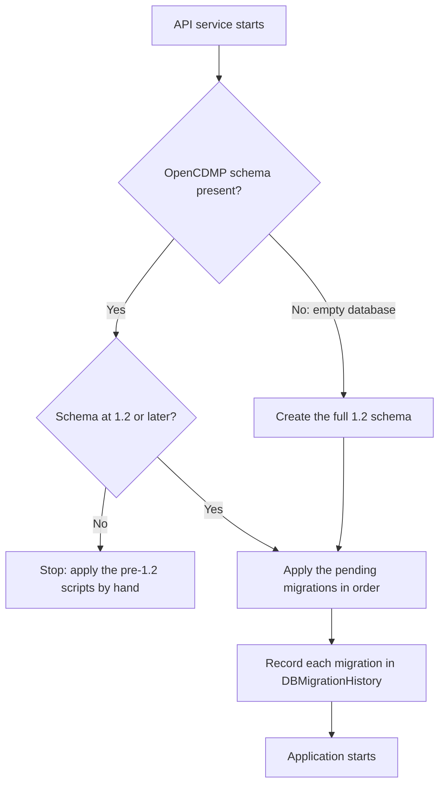

# Upgrade guide

The API service migrates its database automatically when it starts, so an upgrade from version 1.2 or later needs no database scripts run by hand.

---

## Pre-upgrade steps

### 1. Review the release notes {#1-review-release-notes}

Check the [changelog](/docs/deployment/install/changelog.md) and the [OpenCDMP Releases](https://github.com/OpenCDMP/OpenCDMP/releases) page for:

- **New features** and changes
- **Configuration changes** needed
- **Version-specific steps** (see [Version-specific upgrade notes](#version-specific-upgrade-notes) below)
- **Known issues**

### 2. Back up your data

:::danger Critical
Always back up before upgrading. The new version of the API service migrates the database as soon as it starts, and a migrated database cannot be used with the previous version again. The backup is your only way back.
:::

Back up:

- The PostgreSQL database (all OpenCDMP services share it)
- The file storage of the API service (`FILE_STORAGE`)
- Your configuration files (`.env`, `docker-compose*.yml`, and `config-files/` in the Docker example)

The commands are in [Back up](/docs/deployment/install/production.md#back-up).

---

## Upgrade process

### Step 1: Stop the services {#step-1-stop-services}

Stop all OpenCDMP services:

```bash
docker compose down
```

### Step 2: Update the environment variables and Docker tags {#step-2-update-environment-variables-and-docker-tags}

Update the `.env` file in your [docker-deployment](https://github.com/OpenCDMP/docker-deployment) configuration and set the new OpenCDMP version tags:

- `MAIN_APP_TAG` - API service and webapp version
- Other service tags as needed (see the [Docker Compose environment](/docs/deployment/configuration/infrastructure.md#docker))

The images are published on Docker Hub; check that each new tag exists there before you stop the services (see [Registries and image versions](/docs/deployment/configuration/infrastructure.md#registries-and-image-versions)).

:::tip
The `.env` file contains all version tags and configuration variables used by the [docker-compose.yml](https://github.com/OpenCDMP/docker-deployment/blob/main/docker-compose.yml).
:::

### Step 3: Update the configuration files {#step-3-update-configuration-files}

Check the release notes and update the configuration files of **all services**:

1. **API service** (`app-<PROFILE>.env` and the `*-<PROFILE>.yml` files in its `config` folder; `config-files/opencdmp/backend/config/` in the Docker example):
   - Add new environment variables
   - Update changed values
   - Remove deprecated variables

2. **Notification Service**:
   - Update configuration if needed

3. **Annotation Service**:
   - Update configuration if needed

4. **Other Services**:
   - Update any other service configurations

:::tip
Compare your configuration files with the [Configuration Documentation](/docs/deployment/configuration/index.md).
:::

### Step 4: Pull the new images and start the services {#step-4-pull-the-new-images-and-start-services}

Pull the images of the new tags, then start all services:

```bash
docker compose pull
docker compose up -d
```

Watch `docker compose ps` until the services report `healthy`, and follow the log file of the API service while it migrates the database. The Java services write their logs to files, not to the console, so `docker compose logs` shows little for them (see [Logging and monitoring](/docs/deployment/configuration/logging-and-monitoring.md#log-locations)):

```bash
tail -f logs/opencdmp/backend/logging.log
```

The API service applies the pending [database migrations](#database-migrations) before it starts serving requests. Depending on the size of the database and the number of pending migrations, the first start after an upgrade can take noticeably longer than usual.

### Step 5: Verify the upgrade {#step-5-verify-upgrade}

Test critical functionality:
- [ ] All services are running, and `docker compose ps` reports the API service and the plugins as `healthy` (see [Health checks](#health-checks))
- [ ] The **Database** card of the [Maintenance](/docs/administering/maintenance.md#database-migrations) page reports no pending or failed migrations
- [ ] Users can log in
- [ ] Create a new Plan
- [ ] Edit an existing Plan
- [ ] Export functionality works (PDF, DOCX)
- [ ] Search works correctly
- [ ] Admin functions accessible

### Health checks

The API service and the plugins report their health at `/actuator/health` on their own port (`8080` in the Docker example). The example's proxy does not forward `/actuator`, so the endpoint is reachable only from inside the Docker network. The Docker example runs it as the container health check, which `docker compose ps` shows in the **STATUS** column. To call it yourself:

```bash
docker compose exec opencdmp.backend wget -qO- http://localhost:8080/actuator/health
```

A healthy service answers with `"status":"UP"`. See [Logging and monitoring](/docs/deployment/configuration/logging-and-monitoring.md#health-checks) for the other endpoints and the health checks of the other containers.

---

## Database migrations

The API service keeps its database schema up to date with [Flyway](https://documentation.red-gate.com/flyway). Every time it starts, it compares the migrations it ships with the migrations already applied to the database, and applies the missing ones in version order before the application starts.



### What the migrations cover

- **A fresh installation** gets the full schema from an empty database, including the default seed data (plan and asset statuses and workflows, languages, reference types, asset types, and a default blueprint). No initialization scripts are needed.
- **Version 1.2 is the oldest supported starting point.** The API service recognizes a 1.2 database by its schema, so databases that were created from a seed script or patched by hand are accepted as long as they contain the 1.2 changes.
- **The scripts released after 1.2** (`01.00.011` to `01.01.009`) are part of the migrations. Each of them skips the changes that are already present, so an installation that applied some or all of them by hand upgrades without errors.
- **Data transformations** that a release needs (for example the conversion of blueprints, asset templates, and plan values to the 2.0 layout) run as migrations too, in the same order on every installation.
- **The shared database**: the notification, annotation, and KPI services keep their tables (prefixes `ntf_`, `ant_`, and `kpi_`) in the same database and schema, and the API service's migrations create and maintain those tables as well. Tables that already exist are left as they are.

### Migration history

Applied migrations are recorded in the `DBMigrationHistory` table. To see them, open the [Maintenance](/docs/administering/maintenance.md#database-migrations) page and select **View migration history**, or query the table directly:

```sql
SELECT version, description, installed_on, success
FROM "DBMigrationHistory"
ORDER BY installed_rank DESC;
```

Migration versions follow their own numbering (for example `01.01.009` or `2.0.0.006`) and do not match the version of the API service.

The `DBVersion` table that earlier releases used to track hand-applied scripts is no longer written. It stays at `01.01.009`, and new migrations do not add rows to it.

:::note
Database migrations are different from the initialization scripts that the PostgreSQL container runs when it starts for the first time. In the Docker example, those scripts only create the empty databases; see the [PostgreSQL configuration](/docs/deployment/configuration/infrastructure.md#initialization-database-scripts).
:::

### Database user permissions

The API service applies the migrations with the database user of `DB_USER`. This user must be allowed to create, alter, and drop tables, indexes, and constraints in the `public` schema of the OpenCDMP database. The owner of the database has these rights.

### Multiple API instances

When several API service instances start at the same time, one of them applies the migrations while the others wait for it to finish. All instances must run the same version. For what else to set up when you run several instances, see [Run several API instances](/docs/deployment/install/production.md#run-several-api-instances).

### Installations older than 1.2

If the database is older than version 1.2, the API service refuses to start and logs an error such as:

```text
The database is older than OpenCDMP 1.2: it lacks the changes of 01.00.010 (PlanUser ordinal column). Apply the scripts up to 01.00.010 from the db/ folder of OpenCDMP 1.3.0 by hand, then restart.
```

In that case:

1. Restore the database backup if anything was changed.
2. Apply the missing scripts from the [db](https://github.com/OpenCDMP/OpenCDMP/tree/1.3.0/db) folder of the OpenCDMP 1.3.0 release by hand, in version order, up to `01.00.010`. Each script records its version in the `DBVersion` table and does nothing when its version is already recorded. To see which scripts have run, query the table:

   ```sql
   SELECT * FROM "DBVersion" ORDER BY version DESC;
   ```

3. Start the API service again. The automatic migrations take over from there.

:::warning
Do not apply any other database scripts by hand. The scripts after `01.00.010` ship with the API service and run automatically.
:::

### If a migration fails

A migration that fails is rolled back, and the API service stops instead of starting with a partially migrated database. The log of the API service names the migration and the cause. Data transformations name the item they could not process, for example:

```text
The definition of plan blueprint <id> could not be parsed. Fix it, then restart.
```

To recover:

1. Read the error in the log of the API service (`logs/opencdmp/backend/logging.log` in the Docker example).
2. Fix the cause: correct the item named in the message, grant the missing database permissions, or free the resource that blocked the migration.
3. Start the API service again. Migrations that completed before the failure are not repeated, and the failed migration runs again.
4. If the cause cannot be fixed, restore the backup and start the previous version.

---

## Version-specific upgrade notes

The generic process above applies to every release. The notes below list what a specific release additionally requires.

### Upgrading from 1.2 or 1.3 to 2.0

Version 2.0 introduces a redesigned interface, a new layout for blueprints, asset templates, and plan values, data transfer between organisations, webhooks, Research Insights, and automatic database migrations. Perform the following steps on top of the generic process.

#### 1. Check the starting point

Version 2.0 upgrades databases of version 1.2 and later automatically. An installation older than 1.2 must first apply the scripts of the `db` folder by hand, up to `01.00.010` (see [Installations older than 1.2](#installations-older-than-12)).

Do not apply the `01.00.011` to `01.01.009` scripts by hand: they ship with the API service and run at startup. Scripts that you already applied by hand are recognized and skipped.

#### 2. Update the API service configuration

- **Removed**: the legacy public API and all `PUBLIC_API_*` variables (`public-api.yml`) no longer exist; remove them from your `app.env`.
- **Removed**: `dashboard.yml` and its `dashboard.reference-type-counters` setting no longer exist; delete any `dashboard-<profile>.yml` override from your `config` folder. The reference type rows of the Dashboard **Overview** card now follow the [References shown in lists](/docs/administering/tenant-management/content-defaults.md#references-shown-in-lists) setting for plan lists. Configure it on the default tenant to choose the rows that anonymous visitors see.
- **No longer used**: `SUPPORTIVE_MATERIAL_LANGUAGE_PATH`. The API service no longer reads language files; the webapp ships the translations, and the texts stored for each language are overrides on top of them. Remove the variable and any volume that mounts the language files into the API container (in the Docker example, the `config-files/opencdmp/backend/i18n` folder mounted at `/i18n`).
- **New optional variables** (see the [backend configuration reference](/docs/deployment/configuration/backend/index.md) for details):
  - `ANNOTATION_SERVICE_URL` - base URL of the annotation service; required only for transferring comments with [Data Transfer](/docs/administering/tenant-management/tenant-transfer.md).
  - `MULTIPART_MAX_FILE_SIZE` and `MULTIPART_MAX_REQUEST_SIZE` - upload limits, now configurable (default `100MB`; previously fixed at `10MB`).
  - `KPI_VIEWER_BOOTSTRAP_ENABLED` and `KPI_VIEWER_BOOTSTRAP_DELAY_SECONDS` - automatic publishing of the KPI indicator and dashboards at startup. **Only with the optional KPI service**; ignore them otherwise.
  - `WEBHOOKS_*` - the [webhooks](/docs/administering/webhooks.md) feature (on by default; `WEBHOOKS_ENABLED=false` switches it off).
  - `REPORT_*` - limits of [Research Insights](/docs/administering/reports.md).
  - `INTEGRATION_EVENT_ENABLED` - optional integration event channel (disabled by default).
- **New configuration files**: `webhook.yml` and `report.yml` are loaded automatically from the classpath, next to the existing ones. As with every other configuration file, you can override them with an external `webhook-<profile>.yml` or `report-<profile>.yml` in your `config` folder; no action is required when the defaults suit you.
- **Database user**: make sure the user of `DB_USER` may create and alter tables in the OpenCDMP database (see [Database user permissions](#database-user-permissions)).

#### 3. Update the webapp configuration

**Only with the optional KPI service**: the webapp `config.json` ships two default KPI dashboard entries under `kpi_service.dashboards` (`dmp_dashboard` and `dmp_admin_dashboard`). If you maintain a `config-override.json` that defines `kpi_service`, compare it with the default `config.json` of the webapp. Without the KPI service, no webapp configuration change is needed.

#### 4. Upgrade the supplementary services

- **Annotation Service**: upgrade to the release matching the API service. The 2.0 API calls the new transfer endpoints (`/api/annotation/transfer/*`) of the annotation service when `ANNOTATION_SERVICE_URL` is set; older annotation releases do not provide them and tenant transfer operations fail for comments.
- **Notification Service**, **file transformers**, **deposit services**, and **evaluators**: upgrade to the tags listed in the [changelog](/docs/deployment/install/changelog.md).
- **DOCX file transformer**: custom DOCX templates that use the `'{OPENCDMP.…}'` placeholders are no longer rendered; exports that would use them fall back to the built-in template. Before upgrading, check the plan and asset templates set for your organisation and on blueprints and asset templates, and recreate those that use the placeholders from the built-in template. See [Templates with `'{OPENCDMP.…}'` placeholders](/docs/optional-services/file-transformers/docx-templates.md#templates-with-opencdmp-placeholders).

#### 5. Start the services and let the migrations run

When the 2.0 API service starts for the first time, it applies, in this order:

1. The database changes of 1.3 and 2.0 that are still missing: the maDMP API tables, plan update requests, plan blueprint types, Terms and Conditions acceptance, deposit metadata, additional entity information, and the `WebhookSubscription` and `WebhookDelivery` tables.
2. The tables of the KPI service, unless the KPI service already created them. They are created whether or not you run the optional KPI service.
3. The conversion of existing content to the 2.0 layout, for all tenants:
   - **Asset templates**: templates that still have *pages* are converted so that the sections of each page sit directly under the definition.
   - **Blueprints**: blueprints with the 1.3 layout (sections with a *label* and *fields*) are converted to the 2.0 layout (sections with a *title* and *field sets*), keeping the order of the fields. The former **Authors/Contributors** (plan users) field is dropped, because plan collaborators are managed outside the editor in version 2.0.
   - **Blueprint sections**: sections that have asset templates and no explicit setting let plan owners change their templates, as they could before the setting existed.
   - **Plan values**: the stored values of every plan, including plan references, are rewritten from the 1.3 per-field format to the 2.0 per-field-set format of its blueprint.
4. The tables that record the task runs of the [Maintenance](/docs/administering/maintenance.md) page.

Items that are already in the 2.0 layout are skipped, so installations that ran the earlier maintenance-page migration actions of a 2.0 pre-release build (tagged `1.4.x-dev`) are safe. Plans whose blueprint no longer exists, or whose values cannot be mapped to any field set of their blueprint, are left untouched and logged as warnings. Each conversion logs a summary line with the number of items inspected and migrated.

:::warning
A template, blueprint, or plan whose stored definition cannot be parsed stops the upgrade (see [If a migration fails](#if-a-migration-fails)). The content stays as it was before the failed step until the item is fixed and the API service is restarted.
:::

The Maintenance page no longer offers data migration actions: **Set canEditAssetTemplates to true**, and the **Migrate Pages**, **Migrate Fields as Asset Template**, and **Migrate Fields as Asset** actions of 2.0 pre-release builds, are replaced by the migrations above.

#### 6. Rebuild the Elasticsearch indexes

The plan index mapping changed in 2.0: the `blueprintId` keyword field was replaced by a nested `blueprint` object (id, label, group, version status, and type), and the nested asset template object gained a `typeId` field. These fields back the new blueprint and asset type filters in the listings. After the API service has started, open the [Maintenance](/docs/administering/maintenance.md#task-groups) page and run **Rebuild plan and asset indexes** from the **Search index** group. Until then, the new filters return no results for existing plans.

#### 7. Review customized languages

The texts that the Languages page stores for a language are now overrides on top of the translations that ship with the webapp. A language saved with an earlier release stores a full copy of all texts, which hides texts added or reworded in 2.0. Open each such language on the [Languages](/docs/administering/system-configuration/languages.md) page and save it: only the texts that differ from the built-in ones are kept. Texts that differ only because the release reworded them also appear as changed; reset those that you did not customize.

<!-- kpi disabled -->
<!-- #### 8. KPI service (optional)

If the [KPI service](/docs/optional-services/kpi.md) is enabled:

- The indicator definition and both dashboard definitions are now published **automatically** about 30 seconds after the API starts (`KPI_VIEWER_BOOTSTRAP_ENABLED`, default `true`). No manual action is needed for them.
- The indicator schema gained the `plan_blueprint_type_id` and `description_template_type_id` keyword fields, and the dashboards gained *per type* charts. To backfill them, run **Points: plan blueprint types** and **Points: asset template types** from the **KPI indicators** group of the [Maintenance](/docs/administering/maintenance.md#task-groups) page. -->

---

## Rollback procedures

If the upgrade fails or causes issues:

1. **Stop services**: `docker compose down`
2. **Restore database** from backup (a migrated database cannot be used with the previous version)
3. **Restore files** from backup
4. **Restore configuration files** from backup
5. **Revert to previous Docker image tags** in `.env`
6. **Start services**: `docker compose up -d`
7. **Verify rollback** - test basic functionality

---

## Troubleshooting

### Services will not start

**Check**:
- Database is running and accessible
- Configuration files are correct (no typos, all required variables set)
- Ports are not already in use
- Container logs for specific errors

### Database migration failed

**Check**:
- The API service log for the name of the failed migration and the cause
- The database user has permission to create and alter tables
- The database is at version 1.2 or later (see [Installations older than 1.2](#installations-older-than-12))
- Items named in the error message (for example a blueprint whose definition cannot be parsed)

See [If a migration fails](#if-a-migration-fails) for the recovery steps.

### Authentication fails after upgrade

**Check**:
- Keycloak service is running
- `IDP_ISSUER_URI` configuration is correct
- Client configuration in Keycloak has not changed
- Network connectivity between services

### Frontend errors

**Check**:
- Backend is running and accessible
- Backend configuration (especially database connection)
- CORS configuration
- The API service is `healthy` (see [Health checks](#health-checks))
- Browser console for specific errors

---

## Post-upgrade checklist

- [ ] All services running
- [ ] `docker compose ps` reports every service with a health check as `healthy`
- [ ] No pending or failed database migrations
- [ ] Critical functionality tested
- [ ] No errors in logs
- [ ] Users notified that upgrade is complete
- [ ] Internal documentation updated with new version
- [ ] Monitor system for 24-48 hours

---

## Best practices

### Always test first
- Test upgrades in a staging environment first, on a copy of the production database
- Never upgrade production without testing

### Schedule wisely
- Upgrade during off-peak hours
- Consider time zones for international users

### Communicate
- Notify users when upgrade is complete

### Monitor
- Watch logs for 24-48 hours after upgrade
- Be ready to roll back if needed
- Respond quickly to user issues

### Document
- Keep an upgrade log
- Document any issues and resolutions
- Update internal procedures based on experience

---

## See also

- [Installation](/docs/deployment/install/index.md) - Initial deployment instructions
- [Before going to production](/docs/deployment/install/production.md) - Backups, sizing, and several API instances
- [Configuration](/docs/deployment/configuration/index.md) - All configuration options
- [Logging and monitoring](/docs/deployment/configuration/logging-and-monitoring.md) - Where the logs are and how to read them
- [Maintenance](/docs/administering/maintenance.md) - Index rebuilds, event resends, and the migration history
- [Troubleshooting](/docs/troubleshooting.md) - Common issues and solutions

---

## Support

For upgrade assistance:

- **Release Notes**: Review carefully before upgrading
- **GitHub Issues**: https://github.com/OpenCDMP/OpenCDMP/issues
- **Email**: opencdmp at cite.gr
