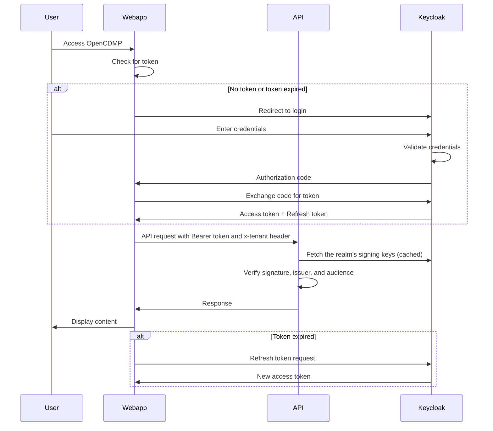

# Integrating with OpenCDMP

Applications and services that call the **OpenCDMP** API authenticate with OAuth2 tokens issued by **Keycloak**.

## Authentication flow overview



For **server-to-server** integrations (no user involved), use the **Client Credentials Flow** instead; see [Client Credentials Flow (for server-to-server communication)](#client-credentials-flow-for-server-to-server-communication) below.

---

## Prerequisites

- **Access to OpenCDMP**: You should have access to an instance of the OpenCDMP platform.
- **Client application**: An application or service that needs to integrate with OpenCDMP APIs.
- **Access to OpenCDMP administrators**: You need to request client credentials from the OpenCDMP/Keycloak administrators.

---

## Steps to integrate

### 1. Request OAuth2 client credentials

Contact the OpenCDMP/Keycloak administrators and request the following:

- **Client ID**: A unique identifier for your application.
- **Client Secret**: A secret key associated with your Client ID.

Provide the following information to the administrators:

- **Application name**: The name of your application or service.
- **Organisations**: The organisations (tenant codes) your application works in, and the role it needs in each.
- **Redirect URIs** (if applicable): The URLs to which Keycloak redirects after authentication (required for web applications using the Authorization Code Flow).

### 2. Choose the appropriate OAuth2 flow

Depending on your application's type, select one of the OAuth2 flows:

- **Authorization Code Flow**: For web applications where users authenticate via a browser. Calls run as the signed-in user, with that user's roles and organisations.
- **Client Credentials Flow**: For server-to-server communication without user interaction. Calls run as the client's service account, which needs its own roles and organisation memberships (see [Give a service account access to OpenCDMP](#give-a-service-account-access-to-opencdmp)).

### 3. Configure your application

Use the obtained Client ID and Client Secret to configure your application:

- **OAuth2 endpoints**: all endpoints sit under the realm URL, which is the `IDP_ISSUER_URI` of the API service:

  - **Authorization endpoint**: `https://<keycloak-host>/auth/realms/<realm>/protocol/openid-connect/auth`
  - **Token endpoint**: `https://<keycloak-host>/auth/realms/<realm>/protocol/openid-connect/token`
  - **User info endpoint**: `https://<keycloak-host>/auth/realms/<realm>/protocol/openid-connect/userinfo`

  Replace `<keycloak-host>` with the Keycloak host and `<realm>` with the realm used by OpenCDMP (`OpenCDMP` in the Docker example). The `/auth` prefix is the Keycloak relative path that the [Docker example](/docs/deployment/install/index.md) sets (`KC_HTTP_RELATIVE_PATH=/auth`) and serves through its proxy; a Keycloak without a relative path serves the same endpoints at `https://<keycloak-host>/realms/<realm>/...`.

- **Scopes**: request the `api` scope. It adds the `api` audience to the token, and the API service refuses tokens without the audience configured in its `SECURITY_AUDIENCE` (`api` in the Docker example). Add `openid`, `profile`, and `email` as your application needs. The client also needs the `tenant_role` client scope as a default scope, which the Keycloak administrator adds: it puts the organisation memberships into the token (`tenant_roles`), without which every call that names an organisation is refused.

### 4. Implement the OAuth2 flow

#### Authorization Code Flow (for web applications)

1. **Redirect the user to the authorization endpoint** with the following query parameters:

   - `client_id`: Your Client ID.
   - `redirect_uri`: Your application's redirect URI.
   - `response_type`: `code`
   - `scope`: Requested scopes (e.g., `openid profile email api`).

2. **Handle the authorization response**: after the user authenticates, Keycloak redirects to your `redirect_uri` with a `code` parameter.

3. **Exchange the authorization code for an access token** with a POST request to the token endpoint with:

   - `grant_type`: `authorization_code`
   - `code`: The authorization code received.
   - `redirect_uri`: Same as above.
   - `client_id` and `client_secret`: Your credentials.

4. **Store and use the access token**: receive the access token and the optional refresh token, and use the access token to call the OpenCDMP API.

#### Client Credentials Flow (for server-to-server communication)

1. **Request an access token** with a POST request to the token endpoint with:

   - `grant_type`: `client_credentials`
   - `client_id` and `client_secret`: Your credentials.
   - `scope`: `api`

2. **Use the access token** to authenticate API requests to OpenCDMP.

### 5. Access OpenCDMP APIs

Include the access token in the `Authorization` header of your HTTP requests, and name the organisation with the `x-tenant` header (see [Addressing an organisation](/docs/developers/api-usage.md#addressing-an-organisation-x-tenant)):

```http
Authorization: Bearer <access_token>
x-tenant: <tenant-code>
```

### 6. Refresh tokens (if applicable)

If your application receives a refresh token, you can use it to obtain new access tokens without re-authenticating. Make a POST request to the token endpoint with:

- `grant_type`: `refresh_token`
- `refresh_token`: The refresh token received.
- `client_id` and `client_secret`: Your credentials.

The Client Credentials Flow does not issue refresh tokens; request a new access token when the current one expires.

---

## Give a service account access to OpenCDMP

A token from the Client Credentials Flow belongs to the client's service account. OpenCDMP treats it like any other user: it creates an OpenCDMP account for it on the first call and takes its roles and organisation memberships from the token. A Keycloak administrator sets the client up as described in [Create an integration client](/docs/deployment/configuration/keycloak.md#integration-client):

- a confidential client with **Service account roles** on and **Standard flow** off;
- the `api` client scope, which adds the `api` audience, and the `tenant_role` client scope, which adds the `tenant_roles` claim;
- the service account in `/opencdmp-app/role-user`, for the `User` role of the `api` client (read from `IDP_CLAIMS_ROLES_PATH`, `api.roles` in the Docker example), and in the `tenant-<tenant-code>` subgroup of the organisation role it needs in each organisation, for example `/opencdmp-app/tenant-role-user/tenant-uporto` to be a Member of `uporto`.

Decode a token to check that `aud` contains `api`, that `resource_access.api.roles` lists the roles, and that `tenant_roles` lists the organisations, for example `TenantUser:uporto`:

```bash
echo "$ACCESS_TOKEN" | jq -R 'split(".")[1] | gsub("-"; "+") | gsub("_"; "/") | @base64d | fromjson | {aud, resource_access, tenant_roles}'
```

Then send the tenant code of one of those organisations in the `x-tenant` header of each call.

---

## Additional considerations

- **Token validation**: The API service validates tokens itself: it checks the signature with the realm's public keys, the issuer against `IDP_ISSUER_URI`, and the audience against `SECURITY_AUDIENCE`. If your own service receives tokens, validate them the same way, or use Keycloak's introspection endpoint.
- **SSL/TLS**: Ensure all communication with Keycloak and OpenCDMP APIs is over HTTPS to protect credentials and tokens.
- **Error handling**: Implement proper error handling for authentication failures and token expiration.
- **Scope management**: Request only the scopes necessary for your application to follow the principle of least privilege.
- **Logout**: If your application requires user logout functionality, redirect users to the Keycloak logout endpoint.
- **Refresh tokens**: Store refresh tokens securely to prevent unauthorized access.

---

## Sample code snippets

### Requesting an access token (Client Credentials Flow)

```bash
curl -X POST \
  'https://<keycloak-host>/auth/realms/<realm>/protocol/openid-connect/token' \
  -H 'Content-Type: application/x-www-form-urlencoded' \
  -d 'grant_type=client_credentials' \
  -d 'client_id=YOUR_CLIENT_ID' \
  -d 'client_secret=YOUR_CLIENT_SECRET' \
  -d 'scope=api'
```

### Accessing an OpenCDMP API endpoint

```bash
curl -H 'Authorization: Bearer <access_token>' \
  -H 'x-tenant: <tenant-code>' \
  'https://<opencdmp-host>/api/principal/me'
```

See the [API usage guide](/docs/developers/api-usage.md) for complete examples.

---

## Contacting OpenCDMP/Keycloak administrators

When reaching out to OpenCDMP/Keycloak administrators, provide the following information:

- **Your name and contact information**
- **Purpose of integration**: Brief description of your application's use case.
- **Required access**: The organisations and the OpenCDMP resources your application needs to access.
- **Redirect URIs**: For web applications using the Authorization Code Flow.

---

## Useful links

- [Keycloak documentation](https://www.keycloak.org/documentation)
- [OAuth 2.0](https://oauth.net/2/)
- [OpenID Connect](https://openid.net/connect/)

---

## Support

If you have any questions or need assistance with integration:

- **Email**: opencdmp at cite.gr
- **GitHub Issues**: [OpenCDMP issue tracker](https://github.com/OpenCDMP/OpenCDMP/issues)
