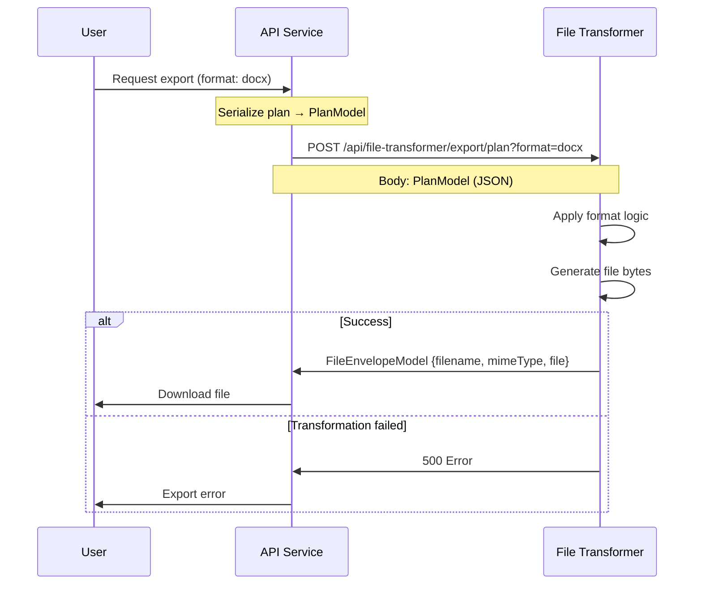
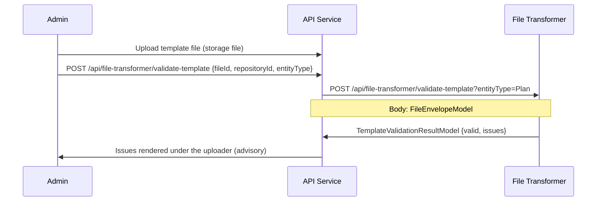

# File transformer

:::info
[File Transformer Base](https://mvnrepository.com/artifact/org.opencdmp/file-transformer-base) is a **Maven package** that provides the base interfaces and configuration classes required to implement custom file transformer services for the **OpenCDMP** platform. Each file transformer is an independent Spring Boot microservice that OpenCDMP calls to support import and export operations for a specific file format.
:::

## How it works

When a user exports a plan or asset (named *description* in the API and plugin contracts), or imports from a file, the OpenCDMP backend:

1. Looks up the registered file transformer for the requested format.
2. Serializes the plan or asset into [Common Models](/docs/developers/plugins/common-models.md) (`PlanModel`, `DescriptionModel`).
3. Calls the transformer's REST API with the model as the request body.
4. Receives back a `FileEnvelopeModel` (for export) or a `PlanModel`/`DescriptionModel` (for import).

Your transformer is responsible for everything in between (rendering, parsing, mapping fields), using whatever libraries suit your format.



---

## Key interfaces and classes

### 1. FileTransformerClient

This interface defines the business logic operations your transformer must implement.

```java
public interface FileTransformerClient {

    // Export a plan to a file in the specified format variant
    FileEnvelopeModel exportPlan(PlanModel plan, String variant);

    // Import a plan from a file, mapped to the provided blueprint
    PlanModel importPlan(PlanImportModel planImportModel);

    // Export a single description to a file
    FileEnvelopeModel exportDescription(DescriptionModel descriptionFileTransformerModel, String format);

    // Import a description from a file, mapped to the provided template
    DescriptionModel importDescription(DescriptionImportModel descriptionImportModel);

    // Return this transformer's capabilities (supported formats, entity types)
    FileTransformerConfiguration getConfiguration();

    // Inspect a file before import and return structural info about it (optional)
    PreprocessingPlanModel preprocessingPlan(FileEnvelopeModel fileEnvelopeModel);
    PreprocessingDescriptionModel preprocessingDescription(FileEnvelopeModel fileEnvelopeModel);

    // Validate an uploaded export template before it is saved (optional — default returns null)
    default TemplateValidationResultModel validateTemplate(FileEnvelopeModel fileEnvelopeModel, PluginEntityType entityType) {
        return null;
    }
}
```

Methods you do not need to support can return `null` or throw `UnsupportedOperationException`. Declare only the formats you handle in your `FileTransformerConfiguration`.

### 2. FileTransformerController

This interface defines the REST API endpoints your microservice must expose. Implement it as a `@RestController` and delegate each method to your `FileTransformerClient`.

```java
@RequestMapping("/api/file-transformer")
public interface FileTransformerController {

    @PostMapping("/export/plan")
    FileEnvelopeModel exportPlan(@RequestBody PlanModel planModel,
        @RequestParam(value = "format", required = false) String format);

    @PostMapping("/export/description")
    FileEnvelopeModel exportDescription(@RequestBody DescriptionModel descriptionModel,
        @RequestParam(value = "format", required = false) String format);

    @PostMapping("/import/plan")
    PlanModel importFileToPlan(@RequestBody PlanImportModel planImportModel);

    @PostMapping("/import/description")
    DescriptionModel importFileToDescription(@RequestBody DescriptionImportModel descriptionImportModel);

    @PostMapping("/preprocessing/plan")
    PreprocessingPlanModel preprocessingPlan(@RequestBody FileEnvelopeModel fileEnvelopeModel);

    @PostMapping("/preprocessing/description")
    PreprocessingDescriptionModel preprocessingDescription(@RequestBody FileEnvelopeModel fileEnvelopeModel);

    @GetMapping("/formats")
    FileTransformerConfiguration getSupportedFormats();

    // Optional capability: validates an uploaded export template. Transformers that do not
    // support template validation keep the default and return null.
    @PostMapping("/validate-template")
    default TemplateValidationResultModel validateTemplate(@RequestBody FileEnvelopeModel fileEnvelopeModel,
        @RequestParam(value = "entityType", required = false) PluginEntityType entityType) {
        return null;
    }
}
```

### 3. FileTransformerConfiguration

Return this from `getConfiguration()` / `getSupportedFormats()` to tell the platform what your transformer can do.

```java
public class FileTransformerConfiguration {
    private String fileTransformerId;                    // Unique ID for this transformer
    private List<FileFormat> exportVariants;             // Formats this transformer can export
    private List<PluginEntityType> exportEntityTypes;     // Plan | Description
    private List<FileFormat> importVariants;             // Formats this transformer can import
    private List<PluginEntityType> importEntityTypes;
    private boolean useSharedStorage;                    // Whether to use shared file storage
    private List<ConfigurationField> configurationFields;     // Admin-configured fields (API keys, templates)
    private List<ConfigurationField> userConfigurationFields; // User-configured fields (personal tokens) 
    private SemanticsManifest semantics; // Optional: the semantic keys this service reads — see Semantics Manifest Models in Common Models
}
```
Publishing a `semantics` manifest lets the blueprint and asset template editors suggest your repository's keys (for example `rda.*`) and show what your service will send from a given structure. See [Semantics Manifest Models](/docs/developers/plugins/common-models.md#semantics-manifest-models).

:::note
`PluginEntityType` is the shared [common-models enum](/docs/developers/plugins/common-models.md#key-enums) (`Plan` | `Description`); file-transformer-base does not declare its own entity-type enum.
:::

**`FileFormat`** describes a single supported format:

```java
public class FileFormat {
    private String format;   // Format identifier string (e.g. "docx", "pdf", "rda-json")
    private Boolean hasLogo; // Whether a logo/icon is associated
    private String icon;     // Icon identifier or URL
}
```

### 4. Import models

**`PlanImportModel`**: the input to `importPlan`. Contains the uploaded file and the blueprint to map into:

```java
public class PlanImportModel {
    private PlanBlueprintModel blueprintModel;              // The target blueprint structure
    private List<DescriptionImportModel> descriptions;      // Descriptions to import alongside the plan (if any)
    private FileEnvelopeModel file;                         // The uploaded file
}
```

**`DescriptionImportModel`**: the input to `importDescription`, and also nested inside `PlanImportModel.descriptions` when a plan import includes descriptions:

```java
public class DescriptionImportModel {
    private DescriptionTemplateModel descriptionTemplate; // The target template
    private String sectionId;                             // Which blueprint section to import into
    private String id;                                    // Existing description ID, when updating one already in the plan
    private FileEnvelopeModel file;                        // The uploaded file
}
```

### 5. Preprocessing models

Preprocessing is called before import to let the transformer inspect the file and return structural information, for example to let the user map sections from the file to blueprint sections.

```java
public class PreprocessingPlanModel {
    private String label;                                                  // Plan title found in the file
    private List<PreprocessingDescriptionModel> preprocessingDescriptionModels; // Descriptions found in the file
}

public class PreprocessingDescriptionModel {
    private String id;     // Identifier within the file (used to reference it during import)
    private String label;  // Description title found in the file
}
```

If your transformer does not support preprocessing, return `null` from these methods.

### 6. Template validation models

Validating an uploaded export template (e.g. a `.docx` file with placeholders) is optional: `FileTransformerClient.validateTemplate()` and `FileTransformerController.validateTemplate()` are `default` methods that return `null` unless you override them.

```java
public class TemplateValidationResultModel {
    private boolean valid;
    private List<TemplateValidationIssueModel> issues;
}

public class TemplateValidationIssueModel {
    private TemplateValidationIssueLevel level; // Enum: Error | Warning
    private String code;                        // Machine-readable issue identifier
    private String message;                     // Human-readable description of the issue
}
```

`TemplateValidationIssueLevel` enum: `Error` (0), `Warning` (1).

---

## Template validation

When an administrator uploads a file into a `File`-typed [configuration field](/docs/developers/plugins/common-models.md#plugin-configuration-models) of a file transformer plugin (under **Settings > Plugins**, or on a plan blueprint or asset template), the platform asks the transformer whether the file is a usable template:

1. The frontend stores the uploaded file and calls `POST /api/file-transformer/validate-template` on the platform with `{ fileId, repositoryId, entityType }`, where `repositoryId` is your `fileTransformerId` and `entityType` is the first value of the field's `appliesTo` (`Plan` when the field declares none).
2. The platform loads the file, wraps it in a `FileEnvelopeModel` (with `fileRef` set when the transformer uses shared storage) and calls `POST /api/file-transformer/validate-template?entityType=Plan|Description` on your service.
3. Your `validateTemplate()` returns a `TemplateValidationResultModel`. Each issue is shown under the uploader as a warning or error row with its `message`.

The result is **advisory**: the platform never blocks the upload or the save, and a failing call is silently ignored. Use `Warning` for placeholders you do not recognize or styles that will fall back to defaults, and `Error` for a file you cannot render at all. A transformer that keeps the default implementation returns `null` and no rows are shown.



---

## Per-export options and selective export

Users can adjust a transformer's **user configuration fields** for a single export. When the selected transformer advertises `userConfigurationFields` whose `appliesTo` includes the exported entity type, the frontend opens an **Export Options** dialog before the export, rendering each field by its `DataType` (dropdown, toggle, color picker, number, or text). A blank value keeps the user's stored preference, and the last choices are remembered per transformer in the browser.

On the wire, the chosen values are sent as an `options` map (`code` → value) on the platform's `ExportRequestModel`. The platform threads them into the common model **as user plugin-configuration values for your transformer**, overriding the stored user preferences for that call:

- On `PlanModel.getCreator().getAdditionalInfo().getPluginConfigurations()` the platform finds (or adds) the `PluginUserModel` with `code` equal to your `fileTransformerId` and `type` `FileTransformer`.
- For each option, the `PluginUserFieldModel` with the matching `code` gets its `textValue` set (or is added).
- For asset exports the same is done on `description.getPlan()`.

Your transformer reads per-export options through the same mechanism it uses for user configuration; there is no separate wire or plugin contract. Read the value from the creator's plugin configuration by field code and fall back to your default when it is absent.

### Selective export

Two field codes are recognized by the frontend and rendered as checklists instead of generic inputs when a **plan** is exported from the plan overview:

| Code | Rendered as | Value sent |
|---|---|---|
| `include-sections` | **Sections to include**: one checkbox per blueprint section, all checked by default | Comma-separated blueprint section ids to include. Omitted when every section is checked. Export is disabled when no section is left. |
| `exclude-descriptions` | **Assets to include**: one checkbox per asset of the plan, all checked by default | Comma-separated description (asset) ids to **exclude**. Omitted when every asset is checked. |

To offer selective export, declare both (or either) as `userConfigurationFields` of type `String` with `appliesTo` containing `Plan`, and honor the values in `exportPlan()`: render only the listed sections when `include-sections` is present, and skip the listed descriptions when `exclude-descriptions` is present. Unlike the other options, selective choices are not remembered between exports.

---

## How to create a custom file transformer

### Prerequisites

- Java 21+
- Spring Boot 4 (the reference implementations use 4.0)
- Maven 3.6+

### Step 1 — Create a Spring Boot project

:::info Versions
Use the latest release of `file-transformer-base` and `common-models` from [Maven Central](https://central.sonatype.com/namespace/org.opencdmp). The contract described here, including template validation, per-export options, and selective export, ships with the 2.0 release. Define the `opencdmp.plugin-base.version` and `opencdmp.common-models.version` properties of the snippet below in the `<properties>` of your `pom.xml`. The reference implementations build on Spring Boot 4.0 and Java 21.
:::

Create a new Maven-based Spring Boot project. Add the following dependencies to your `pom.xml`:

```xml
<dependencies>
    <!-- OpenCDMP base interfaces -->
    <dependency>
        <groupId>org.opencdmp</groupId>
        <artifactId>file-transformer-base</artifactId>
        <version>${opencdmp.plugin-base.version}</version>
    </dependency>

    <!-- Common models (transitive via file-transformer-base, but explicit is clearer) -->
    <dependency>
        <groupId>org.opencdmp</groupId>
        <artifactId>common-models</artifactId>
        <version>${opencdmp.common-models.version}</version>
    </dependency>

    <!-- Spring Boot -->
    <dependency>
        <groupId>org.springframework.boot</groupId>
        <artifactId>spring-boot-starter-web</artifactId>
    </dependency>
</dependencies>
```

### Step 2 — Implement FileTransformerClient

Create a `@Service` class that implements the business logic:

```java
@Service
public class MyFormatFileTransformerService implements FileTransformerClient {

    @Override
    public FileTransformerConfiguration getConfiguration() {
        FileTransformerConfiguration config = new FileTransformerConfiguration();
        config.setFileTransformerId("my-format-transformer");

        // Declare supported export formats
        FileFormat exportFormat = new FileFormat();
        exportFormat.setFormat("myformat");
        config.setExportVariants(List.of(exportFormat));
        config.setExportEntityTypes(List.of(PluginEntityType.Plan));

        // Declare supported import formats (if applicable)
        config.setImportVariants(List.of(exportFormat));
        config.setImportEntityTypes(List.of(PluginEntityType.Plan));

        return config;
    }

    @Override
    public FileEnvelopeModel exportPlan(PlanModel plan, String variant) {

        // 1. Read the plan data you need
        String title = plan.getLabel();
        List<DescriptionModel> descriptions = plan.getDescriptions();

        // 2. Build the output file in your format
        byte[] fileContent = renderPlanToMyFormat(plan);

        // 3. Return the result as a FileEnvelopeModel
        FileEnvelopeModel result = new FileEnvelopeModel();
        result.setFilename(title + ".myformat");
        result.setMimeType("application/x-myformat");
        result.setFile(fileContent);
        return result;
    }

    @Override
    public PlanModel importPlan(PlanImportModel importModel) {
        byte[] fileContent = importModel.getFile().getFile();
        PlanBlueprintModel blueprint = importModel.getBlueprintModel();

        // Parse the file and map fields back to a PlanModel
        PlanModel result = new PlanModel();
        // ... populate fields from the parsed file ...
        return result;
    }

    @Override
    public FileEnvelopeModel exportDescription(DescriptionModel description, String format) {
        // Export a single description
        // Return null or throw UnsupportedOperationException if not supported
        return null;
    }

    @Override
    public DescriptionModel importDescription(DescriptionImportModel importModel) {
        return null; // Not supported
    }

    @Override
    public PreprocessingPlanModel preprocessingPlan(FileEnvelopeModel fileEnvelope) {
        return null; // Not supported
    }

    @Override
    public PreprocessingDescriptionModel preprocessingDescription(FileEnvelopeModel fileEnvelope) {
        return null; // Not supported
    }

    private byte[] renderPlanToMyFormat(PlanModel plan) {
        // Your format-specific rendering logic here
        return new byte[0];
    }
}
```

#### Reading asset field answers

Asset answers are stored in `description.getProperties()`. The structure is:

```text
PropertyDefinitionModel
  └── fieldSets: Map<fieldSetId, PropertyDefinitionFieldSetModel>
        └── items: List<PropertyDefinitionFieldSetItemModel>  (one per multiplicity row)
              └── fields: Map<fieldId, FieldModel>
                    └── textValue / booleanValue / dateValue / references / file / ...
```

To read a specific answer:

```java
PropertyDefinitionModel props = description.getProperties();
if (props == null || props.getFieldSets() == null) return;

PropertyDefinitionFieldSetModel fieldSet = props.getFieldSets().get("fieldSetId");
if (fieldSet == null || fieldSet.getItems() == null) return;

for (PropertyDefinitionFieldSetItemModel item : fieldSet.getItems()) {
    FieldModel answer = item.getFields().get("fieldId");
    if (answer != null && answer.getTextValue() != null) {
        String value = answer.getTextValue();
        // use the value
    }
}
```

To find the `fieldSetId` and `fieldId` values, inspect the `DescriptionTemplateModel` definition passed with the model.

### Step 3 — Implement FileTransformerController

Create a `@RestController` that implements the controller interface and delegates to your service:

```java
@RestController
public class MyFormatTransformerController implements FileTransformerController {

    private final MyFormatFileTransformerService service;

    public MyFormatTransformerController(MyFormatFileTransformerService service) {
        this.service = service;
    }

    @Override
    public FileEnvelopeModel exportPlan(PlanModel planModel, String format) {
        return service.exportPlan(planModel, format);
    }

    @Override
    public PlanModel importFileToPlan(PlanImportModel planImportModel) {
        return service.importPlan(planImportModel);
    }

    @Override
    public FileEnvelopeModel exportDescription(DescriptionModel descriptionModel, String format) {
        return service.exportDescription(descriptionModel, format);
    }

    @Override
    public DescriptionModel importFileToDescription(DescriptionImportModel descriptionImportModel) {
        return service.importDescription(descriptionImportModel);
    }

    @Override
    public PreprocessingPlanModel preprocessingPlan(FileEnvelopeModel fileEnvelopeModel) {
        return service.preprocessingPlan(fileEnvelopeModel);
    }

    @Override
    public PreprocessingDescriptionModel preprocessingDescription(FileEnvelopeModel fileEnvelopeModel) {
        return service.preprocessingDescription(fileEnvelopeModel);
    }

    @Override
    public FileTransformerConfiguration getSupportedFormats() {
        return service.getConfiguration();
    }
}
```

### Step 4 — Create the application entry point

```java
@SpringBootApplication(scanBasePackages = {
    "org.opencdmp.filetransformerbase",
    "com.example.myformattransformer"   // your package
})
public class MyFormatTransformerApplication {
    public static void main(String[] args) {
        SpringApplication.run(MyFormatTransformerApplication.class, args);
    }
}
```

### Step 5 — Configure security and deploy

OpenCDMP calls your plugin with a Bearer token that it obtains from Keycloak for the `plugins` client scope (see [Registering plugin services](/docs/deployment/configuration/plugin-services.md#plugin-tokens)). Your service must accept only tokens from the installation's realm with the `plugins` audience. The reference implementations do this with a `SecurityConfiguration` class (Spring Security's OAuth2 resource server through `gr.cite:oidc-authn`), a `security.yml`, and an `idpclaims.yml`; copy them from one of the [reference implementations](#reference-implementations), and set:

| Env Variable | Description | Example |
| --- | --- | --- |
| `IDP_ISSUER_URI` | The realm URL, the same value as the `IDP_ISSUER_URI` of the API service | `https://<keycloak-host>/auth/realms/OpenCDMP` |
| `SECURITY_AUDIENCE` | The audience the tokens must carry | `plugins` |
| `IDP_CLAIMS_ROLES_PATH` | Path of the roles in the token's `resource_access` claim | `plugins.roles` |

Keep the `/api` endpoints authenticated and leave only `/actuator` open, as the reference `security.yml` does:

```yaml
web:
  security:
    enabled: true
    authorized-endpoints: [ api ]
    allowed-endpoints: [ actuator ]
    idp:
      resource:
        token-type: JWT
        jwt:
          issuer-uri: ${IDP_ISSUER_URI}
          audiences:
            - ${SECURITY_AUDIENCE}
          validIssuer: ${IDP_ISSUER_URI}
```

Set the port and the application name in `application.yml`:

```yaml
server:
  port: 8085

spring:
  application:
    name: my-format-transformer
```

Build and deploy the service as a standalone JAR or Docker container that the OpenCDMP API service can reach on the network.

### Step 6 — Register with OpenCDMP

A plugin becomes available in one of two ways:

- **For the whole installation**: the system administrator adds it to `file-transformer.sources` in the configuration of the API service, with its address, its id, and the client the API service signs in with. See [Registering plugin services](/docs/deployment/configuration/plugin-services.md#plugin-registration), which also shows the Docker Compose entry for a new service.
- **For one organisation**: an organisation administrator connects it with **Add plugin** under **Settings > Plugins**. See [Plugins: add a plugin](/docs/administering/tenant-management/plugins.md#add-a-plugin).

In both cases the platform calls `GET /api/file-transformer/formats` to discover the plugin's capabilities, and the id configured for the plugin must match the id it reports there. The plugin then offers its formats for export and import.

Before you register the plugin, try it against a local installation as described in [Run and test a plugin locally](/docs/developers/plugins/run-locally.md). Once it is registered, **Test connection** on the plugin's page in **Settings > Plugins** checks that the platform can reach it and that the ids match (see [Check the connection](/docs/deployment/configuration/plugin-services.md#step-4-check-the-connection)).

---

## Reference implementations

The following open-source transformers are part of the OpenCDMP platform and serve as complete examples. Each has a documented semantic-to-output-field mapping that shows how the transformer discovers fields in the plan blueprint and asset templates via [`FieldModel.semantics`](/docs/developers/plugins/common-models.md). Use them as a pattern for your own transformer.

| Project | Format | GitHub | Mapping reference |
|---------|--------|--------|-------------------|
| `file-transformer-docx` | Microsoft Word (.docx) | [GitHub](https://github.com/OpenCDMP/file-transformer-docx) | [DOCX templates](/docs/optional-services/file-transformers/docx-templates.md) (template-based; semantics can be used in templates and cover facts) |
| `file-transformer-rda-json` | RDA maDMP JSON | [GitHub](https://github.com/OpenCDMP/file-transformer-rda-json) | [RDA JSON semantics](/docs/optional-services/file-transformers/rda-json-semantics.md) |
| `file-transformer-raid-json` | RAID JSON | [GitHub](https://github.com/OpenCDMP/file-transformer-raid-json) | [RAiD JSON semantics](/docs/optional-services/file-transformers/raid-json-semantics.md) |

---

## License

This package is licensed under the [EUPL 1.2 License](https://github.com/OpenCDMP/file-transformer-base/blob/main/LICENSE).

## Contact

For questions or support regarding the implementation of file transformers, please contact:

- **Email**: opencdmp at cite.gr

:::note
The source code is in the [file-transformer-base repository](https://github.com/OpenCDMP/file-transformer-base).
:::
