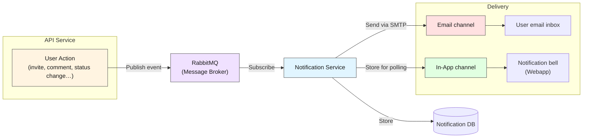

# Notifications

The `Notifications Service` informs users about important events in the platform that relate to them. The contents of these notifications can be [configured](/docs/administering/system-configuration/notification-templates.md) and depend on the type of notification, that is, the event that triggered it. For example, when a user is invited to a [plan](/docs/using/plans/index.md), a notification is sent to that user.

Notifications are sent through one of two channels: `InApp` or `Email`. Each organisation decides which channels every notification may use (**Settings > Notifications**), and users choose which channel comes first in their profile.

## How notifications flow

import DocCardList from '@theme/DocCardList';

<DocCardList />