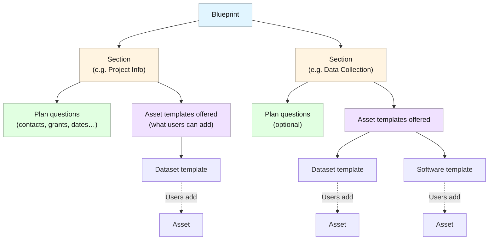

# Blueprints and asset templates

Your organisation prepares the forms you fill in. A **blueprint** sets out the sections and questions of a [plan](/docs/using/plans/index.md), and an **asset template** the questions of an [asset](/docs/using/assets/index.md). You choose a blueprint when you create a plan, and a template when you add an asset; you do not build them yourself.

To browse them, open **Plan Blueprints** or **Asset Templates** under **Library** in the sidebar (see [Library](/docs/using/home.md#library)).

## Blueprints {#blueprints}

A blueprint consists of one or more **sections**. A section can hold questions about the plan as a whole (such as its title, contacts, or funding), offer one or more asset templates so that you can add assets there, or both. At least one section of every blueprint accepts assets.

When you create a plan, the plan takes the sections of the blueprint you chose. The **Select Blueprint** step previews the blueprint section by section before you commit (see [Create or edit a plan](/docs/using/plans/create-or-edit-a-plan.md)). To move a plan to another blueprint, start a [new version](/docs/using/plans/versions.md) of it and choose the blueprint there.

The plan questions include the plan's **Title**, **Description**, **Language**, and **Access**, often its **Contact**, [references](/docs/using/references.md) such as grants and organisations, and the same kinds of questions as asset templates.

## Asset templates {#asset-templates}

An asset template defines the questions of one kind of output, for example a dataset, a piece of software, or a protocol. Its questions are grouped into sections, and every asset is based on exactly one template, chosen when you add the asset. Each asset also has its own **Title**, **Description**, and **Tags**.

Each blueprint section offers its own set of templates, and plan owners can add more from **Manage templates** (see [Manage a section's templates](/docs/using/assets/create-or-edit-an-asset.md#managing-a-sections-templates)). Once an asset is created, its template cannot be changed.

*Asset Templates library*

## What the questions look like {#what-you-may-see-in-a-template}

Blueprints and templates use the same kinds of questions: text, rich text, numbers, dates, yes/no and choice questions, references, links to other plans or assets, and file uploads. Some questions take several answers, some appear only after a certain answer to another question, and some are required. See [Fill in a plan](/docs/using/plans/fill-in-a-plan.md) for how each one behaves.

## New versions {#new-versions}

Administrators update blueprints and templates by creating new versions of them. When the template of one of your draft assets has a newer version, the editor offers to [update the asset](/docs/using/assets/create-or-edit-an-asset.md#updating-to-a-newer-template-version). When the blueprint of your plan has a newer version, the [Plan overview](/docs/using/plans/plan-overview.md) says so, and you can move to it by starting a new version of the plan.

:::info Ask your administrator
If no blueprint or template suits your project, contact your OpenCDMP administrator. How they are built is described in [Plan blueprints](/docs/administering/content-management/blueprints/index.md) and [Asset templates](/docs/administering/content-management/templates/index.md) in the administration guide.
:::
