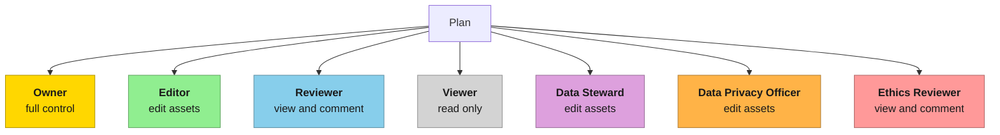

# Work together

A plan can be worked on by a team. To share a plan, open the **Collaborators** panel and invite users, assigning each one a role. The panel opens as a side sheet over the page. Open it from the **Manage** (group icon) button in the **Collaborators** box of the [Plan overview](/docs/using/plans/plan-overview.md) page, or from the **Collaborators** button (group icon) in the [plan editor](/docs/using/plans/create-or-edit-a-plan.md#the-toolbar) toolbar. In the editor, the badge on the button shows how many people collaborate on the plan.

*Collaborators panel*

:::info After the plan is finalized
Only plan owners can invite collaborators. You can still invite people after the plan is [finalized](/docs/using/plans/plan-workflow.md), for example a reviewer or a funder, but the roles and sections of collaborators already on the plan can no longer be changed, and they can't be removed.
:::

## Invite a user {#inviting-a-user}

The panel header shows **Collaborators** and the number of people on the plan. Click **Share** to open the invite form. At the top of the form, a toggle lets you choose the type of collaborator you are adding:

- **Existing collaborator**: lists only users you have already collaborated with on other plans where you were the plan author. Select them from the **User** dropdown.
- **New collaborator**: for anyone else. Enter their **Email** address.

Then choose a **Role** for the collaborator. If the role is neither Owner nor Viewer, you can optionally restrict it to specific **Plan Sections** (choose **All** to apply it to the whole plan). Click **Send invite** to complete the invitation.

What happens next depends on whether the person already has an account:

- **An existing collaborator, or an email address that belongs to an OpenCDMP account**: the person is added to the plan straight away, appears in the collaborator list, and receives a notification about the invitation.
- **An email address without an account**: the person receives an email with an invitation link, and is added to the plan only when they accept it (see [If you are invited](#if-you-are-invited)). Until then they do not appear in the collaborator list.

There is no resend action. If an invitation email went missing, invite the same email address again: every invitation sends a new email.

*Existing collaborator invitation*

## Plan roles

For each collaborator, a role on the plan must be defined. There are seven roles:

| Role | Capabilities |
|---|---|
| **Owner** | Full control: edit all plan content, manage collaborators, change status, download, publish, evaluate, create new versions, delete. Always applies to the whole plan. |
| **Editor** | Edit, finalize, clone, and delete assets in the assigned sections; view all plan content; add comments. |
| **Reviewer** | View and download the plan; add and reply to comments. |
| **Viewer** | View and download the plan. |
| **Data Steward** | Same asset-editing capabilities as an Editor in the assigned sections; add comments. |
| **Data Privacy Officer (DPO)** | Edit assets in the assigned sections; add comments; perform privacy oversight activities. |
| **Ethics Reviewer** | Same as a Reviewer. |

Any role except Owner can be limited to some sections of the plan; it then applies to those sections only.

All roles except Viewer can add comments. See [Comments and review](/docs/using/comments.md) for how comments work.

## Assign sections {#assigning-sections}

Roles can be applied to an entire plan or restricted to specific sections:

- **Owner** and **Viewer** always apply to the whole plan; no section picker is shown for these roles.
- **Editor** and **Data Steward** can be assigned to the sections that contain asset templates.
- **Reviewer**, **Data Privacy Officer**, and **Ethics Reviewer** can be assigned to any section.

Choose **All** in the **Plan Sections** field to apply the role across every section.

### Work on assets {#work-on-assets}

Assigning sections is how a team splits the work on [assets](/docs/using/assets/index.md). An **Editor** (or **Data Steward**) can add new assets and edit the existing ones in the sections they are assigned to, and sees the rest of the plan read-only. Give the role to as many people as you need.

## Manage collaborators {#managing-collaborators}

Collaborators appear in the list ordered by the date they were added. Each row shows the collaborator's name, email address, and role badge. A collaborator can hold more than one role at once: the panel then lists one row per role, while the **Collaborators** box of the Plan overview page shows the roles together (for example `Editor, Viewer`).

For roles other than Owner and Viewer, the row also has a **Sections** selector where you change the sections the role applies to. Use the `⋮` menu next to a collaborator to change their role (**Make** *role*) or to **Remove** them. Once the plan is finalized, existing collaborators can no longer be changed or removed; you can still invite new ones.

A legend at the bottom of the panel reminds you what each of the **Editor**, **Reviewer**, and **Viewer** roles can do.

:::warning
Role and section changes, and removing a collaborator, are not applied until you click the **Save** button that appears at the bottom of the panel. Closing the panel without saving discards those pending changes. Invitations sent with **Send invite** are applied immediately and do not need a separate save.
:::

## If you are invited {#if-you-are-invited}

- **You already have an account**: the plan is shared with you right away and you receive a notification. The plan appears in [My Plans](/docs/using/plans/my-plans.md) and on your [Dashboard](/docs/using/home.md); open it to see its [Plan overview](/docs/using/plans/plan-overview.md).
- **You received an invitation email**: open the link in the email and log in, or create an account, with the email address the invitation was sent to. A link opened from a different account is refused. Once you accept, you are added to the plan with the role you were given (and to its organisation, if you were not a member yet), and the plan's overview opens. The link expires after a period your administrator sets (30 days by default).

What you can do next depends on your role: owners and section editors see **Edit** on the Plan overview, while the other roles see **Preview**, which opens the plan read-only.

## When someone else is editing {#when-someone-else-is-editing}

Several collaborators can have a plan open at the same time; the plan editor toolbar shows their avatars (see [The toolbar](/docs/using/plans/create-or-edit-a-plan.md#the-toolbar)). To keep people from overwriting each other's work, OpenCDMP takes an edit lock as soon as someone opens the plan in the editor, and keeps it while they work on the plan's own fields or on one of its assets. The plan and each asset are locked separately, so two people can work on different assets of the same plan.

While someone else holds the lock:

- The plan editor shows the plan, or the asset, read-only, with a banner such as **This plan is locked for editing** (or **This asset is locked for editing**) that names who holds the lock and since when.
- The Plan overview, or Asset overview, tells you that another user is editing and offers **Preview** instead of **Edit**. **Delete** is disabled.

The lock is released when the other person saves and closes the editor, or leaves it. If you lose your own lock while editing, for example after a long time without activity, the editor disables editing and asks you to reload the page. Administrators can see and release locks under [Edit Locks](/docs/administering/entity-locks.md).
